# Content — Working File

Working drafts of all website content: case studies and articles. More will be added as we go. Before publishing, each item becomes its own file using the front matter in its "Site metadata" section, plus a Bahasa Indonesia version:

- Case studies → `src/content/projects/en/<translationKey>.md`
- Articles → `src/content/posts/en/<translationKey>.md`

Status: drafts have open items marked **[TO CONFIRM]**, **[TO WRITE]**, **[ADD]**, **[CONFIRM]**, or **[DRAFT]**.

## Contents

**Case studies**
1. Drone and AI Monitoring of a National Capital Construction Site
2. Multi-Source Monitoring of a 142 km High-Speed Railway Construction
3. Nationwide Rice Productivity Assessment in One Month
4. Hydropower Feasibility Studies Across Four Remote Sites
5. Landslide Early Warning System for Minihydro Power Plants
6. Mapping Illegal Mining to Protect Communities and Nature
7. Forecasting Belitung's Coastline

**Articles** (series: Digitalising a Construction Company)
- A1. Building the App Was Easy. Getting People to Use It Took Three Months. (Part 1)
- A2. KPI Dashboards for a Construction Company's Leadership (Part 2)

**Articles** (standalone)
- A3. Data Governance Without the Bureaucracy
- A4. Spatial AI in Practice
- A5. Generative AI for a Small Geospatial Team
- A6. When Clients Ask for Blockchain, Quantum or AI First
- A7. Geospatial AI in Indonesia Starts With One Map
- A8. GeoScholar: Cited Answers from Remote Sensing Papers

---

# Case Studies

## 1. Drone and AI Monitoring of a National Capital Construction Site

We flew repeated drone surveys over the site of Indonesia's new national capital and detected every building and structure in the imagery. Each one was checked against the areas where building was permitted, and anything standing in the wrong place was flagged. Comparing one survey with the next gave a dated record of construction across the whole site.

### At a glance

| | |
| --- | --- |
| **Sector** | Infrastructure & Construction (secondary: Urban & Property Development) |
| **Location** | East Kalimantan, Indonesia |
| **Client** | A national government authority |
| **Scope** | Phase 1 of a drone-based mapping and monitoring programme |
| **Year** | [TO CONFIRM] |
| **My role** | Designed and led the programme: drone deployment, data processing, AI analysis, and reporting |
| **Data** | High-resolution aerial imagery and LiDAR from repeated drone surveys |
| **Methods** | Photogrammetry, AI object detection of buildings and structures, overlay with permitted-area maps, change detection between survey dates |
| **Deliverables** | Flagged structures outside permitted areas, dated build history, structure maps, monitoring dashboard, video reports, orthomosaics, 3D models, DEMs |

### The challenge

Many contractors were working at once across a very large area of forest, rivers, and cleared land, and the authority overseeing the new capital needed two questions answered on a regular schedule:

1. Is everything being built in the right place? Every building and structure should stand inside a permitted area, and anything outside has to be found and acted on.
2. What has been built so far, and when did each structure first appear? The authority wanted a record of construction over time across the whole site.

Ground inspections couldn't cover a site this size often enough. Each visit saw only part of it, and results varied between inspectors.

### How we did it

Every monitoring cycle followed the same steps, so results from different dates could be compared directly.

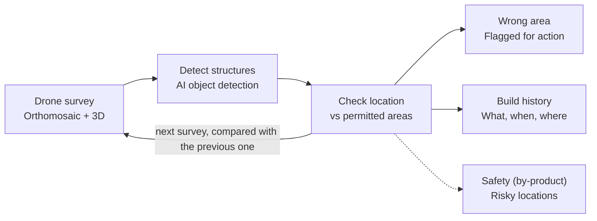

#### 1. Capture

Drones carrying high-resolution cameras and LiDAR sensors flew systematic patterns over the site at regular intervals. Separate video flights used the drone's follow-me mode to film key areas while it tracked a team member on the ground. The LiDAR gave accurate elevation data for measuring heights, volumes, and terrain changes.

#### 2. Process

We processed the imagery and point clouds into orthomosaic maps, 3D models, and digital elevation models (DEMs), which could be measured directly for each survey date.

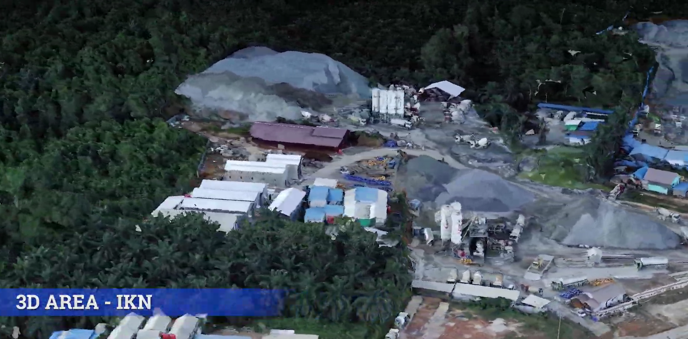

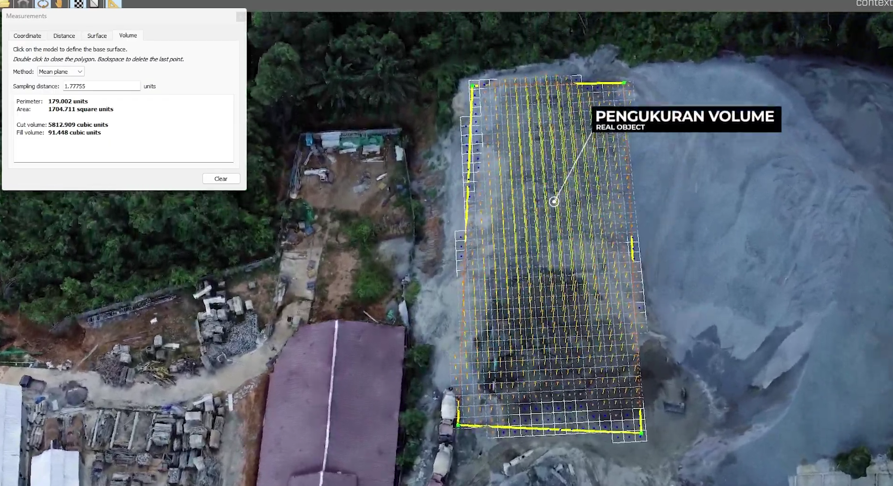

#### 3. Detect structures

AI object detection found the buildings and structures in each new orthomosaic and recorded their footprints and locations. We ran the video footage through the same detection, frame by frame. Then the team checked the results by hand for structures the model had missed.

#### 4. Check location

We overlaid each detected structure on the map of permitted areas. Anything standing outside them was flagged for follow-up.

 shown alongside the drone footage.")

#### 5. Compare over time

We compared each survey with the earlier ones to find new and changed structures and the survey in which each first appeared. After repeated flights, those comparisons added up to a build history for the site.

#### A by-product: safety

Every structure had a known location, so the same check also showed which ones stood in areas unsuitable or risky for building. It used data we already had and needed no separate analysis. [TO CONFIRM: which risk zones were used]

#### 6. Report

We delivered flagged structures and the build history through a monitoring dashboard, video reports, and written reports for the authority's planning and supervision teams.

### What we delivered

After each survey cycle, the authority received the same package:

| Output | What it shows | Who uses it |
| --- | --- | --- |
| Flagged structures | Buildings and structures outside permitted areas, with location and the date first detected | Planning and supervision teams |
| Build history | Every structure and the survey date it first appeared, across all survey dates | Programme managers |
| Monitoring dashboard | Maps, flagged structures, build history, and video in one view | All stakeholders |
| Video reports | Drone footage of key areas, analysed frame by frame for violations | Decision-makers and supervision teams |
| Structure maps | Every detected building and structure on the site | Planners |
| Safety findings (by-product) | Structures in locations unsuitable or risky for building | Site safety teams |
| Orthomosaics, 3D models, DEMs | Measurable base maps for each survey date | Engineers and GIS teams |

### Benefits

- Every survey checked every structure on the site against the permitted areas.
- Repeated surveys showed when a structure first appeared, so follow-up could start from a date.
- The build history came from one method applied the same way each time.
- AI detection made it possible to check every structure on every survey, which manual review couldn't do. [TO CONFIRM: typical turnaround from flight to report]
- The location data we'd already collected also showed structures in risky areas, with no extra survey work.

### Lessons learned

Stakeholders didn't engage much with a written report alone, so we added video. The drone flew in follow-me mode, tracking a team member through the site, and we analysed the footage frame by frame for violations. Seeing a flagged structure in its surroundings worked better than text. A dashboard then put maps, findings, and video in one place.

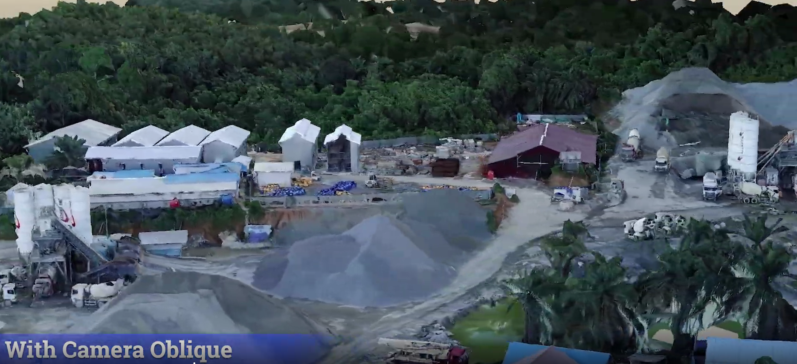

The detection model didn't reliably recognise small or temporary structures, such as workers' sheds (*bedeng*). We added manual checks of its results so these weren't missed. Automated detection does most of the work, but a person still reviews it.

What we'd change in Phase 2:

1. Improve small-structure detection with a feedback loop. Fine-tune the model on labelled local examples (bedeng, tarps, containers, site offices). Use change detection and surface height (LiDAR or DSM) as a second signal, so anything new between surveys gets flagged whatever it looks like. Send low-confidence detections to human review and feed the corrections back into training.
2. Measure detection accuracy. Track how often the model misses or misidentifies each structure type, so we can report accuracy as numbers.
3. Make the video repeatable and geo-referenced. Replace follow-me flights with pre-programmed waypoint routes, so each cycle's footage covers the same path and can be compared directly. Sync the drone's flight log with the video, so every violation found in a frame gets a map coordinate and links to the dashboard. De-duplicate detections across frames, so one structure counts as one finding.
4. Turn the dashboard into a case-tracking tool. Give each flagged structure a status (flagged, verified on the ground, action taken, resolved), add a time slider for the build history, and generate evidence packs with before/after images, dates, and coordinates.
5. Use satellite data to target drone flights. Satellite change detection between drone cycles could send flights to areas where something changed. Cloud cover is frequent in Kalimantan, so radar (SAR) may be more reliable than optical imagery. We'd need to test whether it can detect structures as small as bedeng.
6. Measure the process. Record turnaround from flight to report, area covered per cycle, and findings confirmed on the ground.

### To confirm before publishing

- [ ] Year(s) of Phase 1
- [ ] Area covered (hectares or km²)
- [ ] Number of survey flights and the interval between them
- [ ] Drone and sensor types used
- [ ] Source of the permitted-area map (for example the spatial plan) and how it was supplied
- [ ] Which risk zones were used for the safety by-product (for example steep slopes or flood-prone areas)
- [ ] Number of structures detected and flagged, if shareable
- [ ] Typical turnaround from flight to report
- [ ] Team size and your exact role
- [ ] Whether the authority allows the project to be described publicly, even without its name
- [ ] Any images you're allowed to publish (generic site photos, non-sensitive map extracts)

### Site metadata

```yaml
title: "Drone and AI Monitoring of a National Capital Construction Site"
lang: en
translationKey: national-capital-drone-monitoring
sector: infrastructure-construction
secondarySectors: [urban-property]
client: "A national government authority"
location: "East Kalimantan, Indonesia"
year: null            # TO CONFIRM
role: "Programme lead"
methods: [drone-photogrammetry, lidar, object-detection, spatial-overlay, change-detection]
outcome: "Structures built outside permitted areas flagged, with a dated build history"
summary: "Repeated drone surveys and AI detection checked every structure on a new capital city site against where building was permitted."
featured: true
comments: true
map: false
draft: true
cover: 3d_object_3.png
regions:
  - { name: "East Kalimantan", lon: 116.7, lat: -0.97 }
```

---

## 2. Multi-Source Monitoring of a 142 km High-Speed Railway Construction

We monitored construction along the 142 km Jakarta–Bandung high-speed railway corridor, using drone surveys and computer vision to detect and count construction objects against the schedule. Where drones couldn't fly, satellite imagery covered the gap. A third, lower-priority task was analysing social media and on-site data to help plan responses to community concerns.

### At a glance

| | |
| --- | --- |
| **Sector** | Infrastructure & Construction |
| **Location** | Jakarta to Bandung corridor, through Bekasi, Karawang, and Purwakarta, Indonesia |
| **Client** | A railway construction consortium |
| **Scope** | Construction progress monitoring along about 142 km, plus social media analysis |
| **Year** | [TO CONFIRM] |
| **My role** | Led the monitoring programme, coordinating drone, engineering, and AI teams |
| **Team** | 10 people: 3 UAV operators, 4 engineers, 2 AI engineers, 1 administrator |
| **Data** | Drone imagery and video, satellite imagery, on-site observations, social media data |
| **Methods** | Drone photogrammetry, computer vision object detection and counting, satellite imagery as gap-fill, time-series 3D modelling of selected sections, social media analysis |
| **Deliverables** | Object counts against schedule, progress reports, time-series 3D models, social response strategy, interactive dashboards |

### The challenge

The corridor is a long, thin construction site that crosses dense cities, industrial zones, farmland, and hills. Work goes on at many points at once, so no single inspection gives the full picture. The consortium needed regular answers to three questions:

1. Is construction keeping pace with the schedule? How many pile caps, bored piles, girders, and other elements are in place, and where is work behind?
2. Can monitoring continue when drones can't fly? Weather, permits, or unexpected restrictions can ground flights over parts of the corridor and leave gaps in the record.
3. How is the project perceived, and how should the consortium respond? Infrastructure on this scale affects nearby communities, and public concerns surface quickly on social media.

### How we did it

The main stream was spatial and tracked the physical build. A smaller, third-priority stream analysed social media and on-site data to guide responses to the public. Both fed the same dashboards.

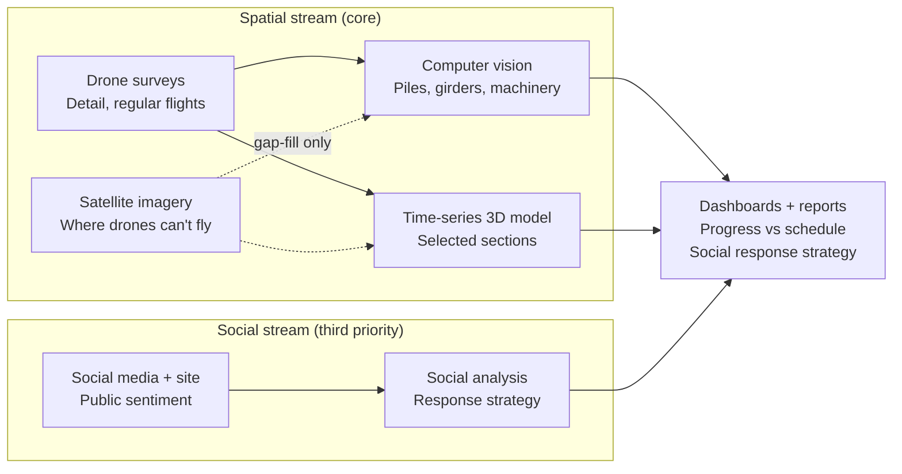

Regular drone flights captured high-resolution imagery and video of active sections, so we could inspect progress and quality and spot deviations from design.

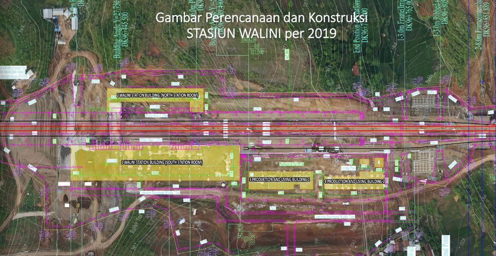

Drones couldn't always fly. Weather, permits, or unexpected events sometimes made flights over part of the corridor impossible or prohibited, and in those periods satellite imagery covered the missing areas so the monitoring record had no gaps.

AI object detection processed the imagery to identify and count construction elements such as pile caps, bored piles, and girders, and to map laydown areas and heavy machinery. We compared the counts with the planned timeline to show which sections were on schedule and which were behind.

For selected sections, we combined the spatial data from each monitoring period into a 3D model, so progress could be compared period by period.

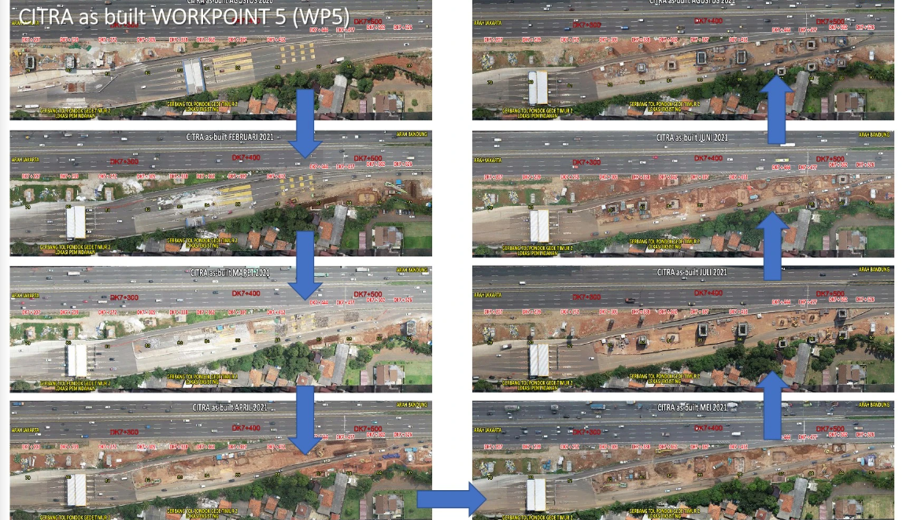

We analysed social media data to understand public sentiment and concerns about the project. Combined with what we gathered on site, it helped the consortium decide how to respond. [TO CONFIRM: platforms and analysis methods used]

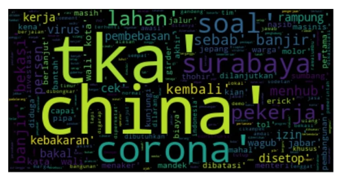

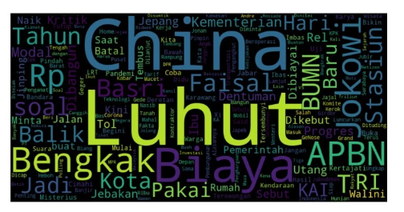

Results went to the consortium as reports, interactive dashboards, and the 3D models.

### What we delivered

| Output | What it shows | Who uses it |
| --- | --- | --- |
| Object counts against schedule | Installed pile caps, bored piles, girders, and other elements compared with the planned timeline | Project managers |
| Site activity maps | Laydown areas and heavy machinery locations | Site managers |
| Progress reports | Status by corridor section, delays, and deviations from design | Project managers and engineers |
| Time-series 3D models | How selected sections changed between monitoring periods | Engineers and stakeholders |
| Gap-fill satellite maps | Areas drones couldn't cover in a given period | Project managers |
| Social response strategy | Public sentiment from social media, combined with on-site findings, with recommended responses | Community relations and management |
| Interactive dashboards | Progress, counts, 3D models, and social insights in one place | All stakeholders |

### Benefits

- Automated counts of pile caps, bored piles, girders, and machinery gave a measured check against the schedule instead of an estimate.
- Satellite imagery covered the areas where weather, permits, or unexpected restrictions stopped flights, so every period had data.
- Time-series 3D models of selected sections showed how they developed, which helped spot bottlenecks and communicate status.
- Social media analysis, combined with on-site data, fed into response plans for community concerns. [TO CONFIRM: an example, if shareable]
- Engineers, managers, and community teams worked from the same dashboards.

### Lessons learned

[TO WRITE] Some prompts:

- What made a long, thin corridor harder to monitor than a single site like IKN (flight permissions near cities, airspace, access, logistics)?
- How well did object counting work on pile caps, bored piles, girders, and machinery? Which objects were hard to recognise?
- How were satellite and drone data reconciled when they disagreed?
- What was hardest about the social media work: data access, data quality, or getting teams to act on it?
- What would you do differently next time?

### To confirm before publishing

- [ ] Year(s) of the engagement
- [ ] Monitoring frequency and number of monitoring cycles
- [ ] Which sections had 3D models (or how many)
- [ ] Social media platforms and analysis methods used
- [ ] An example of a response strategy, if shareable
- [ ] Whether the project can be described publicly without the client's name
- [ ] Any images you're allowed to publish

### Site metadata

```yaml
title: "Multi-Source Monitoring of a 142 km High-Speed Railway Construction"
lang: en
translationKey: high-speed-railway-monitoring
proof: { value: "142 km", label: "Railway corridor monitored", quote: "142 km Jakarta–Bandung high-speed railway corridor" }
sector: infrastructure-construction
secondarySectors: []
client: "A railway construction consortium"
location: "Jakarta–Bandung corridor, Indonesia"
year: null            # TO CONFIRM
role: "Programme lead"
team: 10
methods: [drone-photogrammetry, object-detection, satellite-imagery, time-series-3d, social-media-analysis]
outcome: "Construction progress counted against schedule along 142 km, with no gaps when drones were grounded"
summary: "Drones and computer vision counted construction progress along a 142 km railway, with satellite imagery filling gaps and social media analysis guiding public response."
featured: true
comments: true
map: false
draft: true
cover: citra_asbuilt_wp5.png
regions:
  - { name: "Jakarta–Bandung", lon: 107.25, lat: -6.55 }
```

---
## 3. Nationwide Rice Productivity Assessment in One Month

We predicted rice paddy productivity within a one-month deadline by combining satellite and drone data. Satellite NDVI imagery covered the large area. Drone imagery of sample fields showed how far the satellite readings were off, and we used that error to correct the satellite data before predicting productivity.

### At a glance

| | |
| --- | --- |
| **Sector** | Agriculture & Food Security |
| **Location** | [CONFIRM: rice-producing areas of Java, or nationwide with ground truth in Java] |
| **Client** | A national government ministry |
| **Scope** | Rice paddy productivity prediction |
| **Timeline** | One month |
| **Year** | 2018 (May) |
| **My role** | Project director and data scientist |
| **Team** | 5 UAV teams (3 to 5 people each), 3 GIS engineers, 2 agricultural engineers, 2 data scientists |
| **Data** | Satellite imagery for area coverage; drone (UAV) imagery of sample fields |
| **Methods** | NDVI vegetation index, satellite correction using drone data (mean error), productivity prediction from corrected NDVI |
| **Deliverables** | Productivity maps, yield estimates, regional comparisons |
| **Built on** | An earlier regional pilot using drone near-infrared (NIR) surveys of rice fields |

### The challenge

The government needed an up-to-date picture of rice productivity to guide food security decisions, and it needed it within a month. Two constraints pulled against each other.

1. The area was far too large to survey from the ground or by drone alone, so only satellite imagery could cover it.
2. Satellite imagery is coarser and less accurate than close-range data, so its readings needed checking against something more precise.

We had to keep the reach of the satellites and borrow the accuracy of the drones.

### How we did it

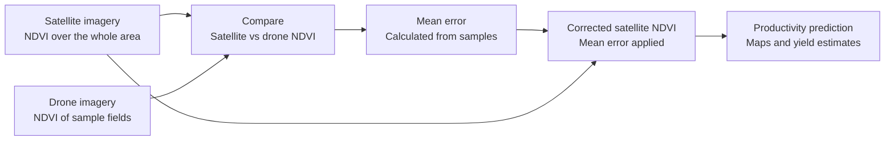

We used the Normalised Difference Vegetation Index (NDVI) of the rice plants as the basis for predicting productivity. The area was too big for anything but satellites, so satellite imagery supplied the NDVI for the whole of it.

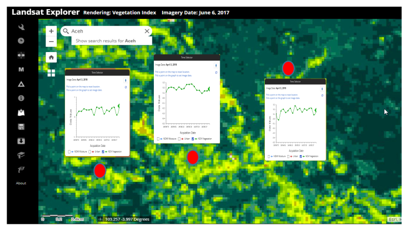

To measure the satellite's error, five UAV teams flew drones over sample fields in parallel to fit the deadline. We compared that drone imagery with the satellite imagery of the same fields and took the difference as the error in the satellite readings.

 and the vegetation index from the same flight (right).")

We then applied the mean error to the satellite imagery, which gave corrected values across the whole area. Productivity was predicted from those corrected NDVI values. [CONFIRM: how NDVI was converted to productivity, for example a regression against yield data]

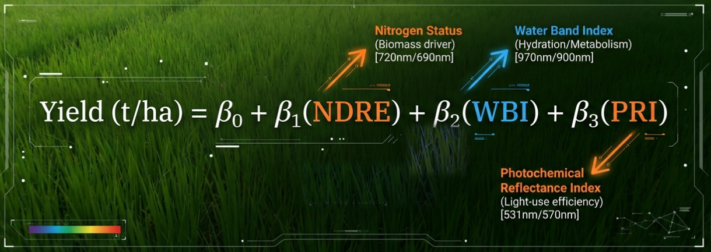

### What we delivered

| Output | What it shows | Who uses it |
| --- | --- | --- |
| Productivity maps | Predicted rice productivity across the study area | Policymakers and agricultural planners |
| Yield estimates | Estimated rice yields by area [TO CONFIRM: district, province, or other level] | Food security planners |
| Regional comparisons | Where productivity is high and low | Policymakers |
| Corrected NDVI dataset | Satellite NDVI corrected with drone measurements | Analysts, for validation and future assessments |
| Report | Findings and recommendations | Ministry decision-makers |

### Benefits

- Combining drones and satellites made a large-area assessment possible on a timeline that field surveys could not meet.
- Drone measurements corrected the satellite readings, so the estimates did not rest on satellite data alone.
- The maps showed where productivity was strong and where it lagged, so interventions could be aimed at the weaker areas.
- The drone-and-satellite approach had first been tested in a regional pilot. It scaled up, and it showed us what to improve next time.

### Lessons learned

The drone data was acquired only once. Rice changes quickly through its growth stages, so a single detailed snapshot couldn't show how the crop developed, and the correction was based on one moment in the season.

We also used satellite data to estimate the age of the rice and to choose where to send field survey teams. Those estimates weren't accurate enough, and some of the first areas chosen weren't at the expected growth stage.

The third gap was NDVI itself. Different rice varieties grow differently, so the same NDVI value doesn't mean the same yield for every variety. Reliable curves relating NDVI to productivity need a database of variety characteristics.

Next time we would do three things.

1. Fly drones several times through the season, so the detailed data has a time reference across growth stages.
2. Check rice age on the ground or with higher-resolution data before choosing field survey sites, instead of relying on satellite data alone.
3. Build a database of rice variety characteristics, and use it to create NDVI-to-productivity curves for each variety.

### To confirm before publishing

- [ ] Scope: the lesson-learned record says "several areas of Java," while the portfolio describes a nationwide assessment. Which is correct?
- [ ] How NDVI was converted to productivity
- [ ] Satellite source (for example Sentinel-2, Landsat, or commercial imagery)
- [ ] Output level: field, district, province?
- [ ] Whether the project can be described publicly without the ministry's name
- [ ] Any images you're allowed to publish

### Site metadata

```yaml
title: "Nationwide Rice Productivity Assessment in One Month"
lang: en
translationKey: national-rice-productivity
proof: { value: "1 month", label: "National rice survey", quote: "within a one-month deadline" }
sector: agriculture-food-security
secondarySectors: []
client: "A national government ministry"
location: "Indonesia"   # CONFIRM: Java or nationwide
year: 2018
role: "Project director and data scientist"
team: "22-32"         # 5 UAV teams of 3-5, plus 7 engineers and data scientists
methods: [ndvi, satellite-imagery, drone-calibration, mean-error-correction, yield-prediction]
outcome: "Rice productivity predicted from drone-corrected satellite NDVI within one month"
summary: "Satellite NDVI, corrected with drone imagery of sample fields, predicted rice productivity within a one-month deadline."
featured: true
comments: true
map: false
draft: true
cover: ortho_vs_hyperspectral.png
regions:
  - { name: "Java", lon: 110.4, lat: -7.3 }
```

---

## 4. Hydropower Feasibility Studies Across Four Remote Sites

Under a 12-month blanket contract, we carried out feasibility studies for hydropower plants at four remote sites in Kalimantan, Sumatra, and Sulawesi. We combined targeted drone LiDAR, drone imagery, field sensors, and official statistics to decide where each plant's key components should go and to forecast flood and erosion risk. All four sites went on to construction.

### At a glance

| | |
| --- | --- |
| **Sector** | Energy |
| **Location** | Four sites in Kapuas Hulu (West Kalimantan), Lampung, and Poso (Central Sulawesi), Indonesia |
| **Client** | A hydropower developer |
| **Scope** | Feasibility studies for four hydropower sites under one blanket contract |
| **Timeline** | 12 months |
| **Outcome** | All four sites proceeded to construction |
| **Year** | [TO CONFIRM] |
| **My role** | Managed the contract and all four studies, overseeing the LiDAR, drone, sensor, statistics, and machine learning workstreams |
| **Data** | Drone LiDAR, drone imagery and video, IoT water-flow and weather sensors, BPS (Statistics Indonesia) data |
| **Methods** | LiDAR processing into terrain models, drone mapping, sensor data analysis, machine learning to forecast flood and erosion areas |
| **Deliverables** | Feasibility reports, topographic maps, 3D models, and DEMs for each site, plus recommended component locations |
| **Built on** | An earlier LiDAR methodology study for a minihydro project in South Sulawesi |

### The challenge

A hydropower plant's output and cost depend heavily on where its parts go: the intake, the water channel, the turbine, and the powerhouse. Placing them well needs accurate terrain and water data, and the developer needed that for four very different sites in one year.

1. Dense forest, hills, and rivers make ground surveys slow, and the forest canopy hides the ground from ordinary aerial photos.
2. Each site has its own rivers, terrain, and communities, but the developer needed results it could compare across sites to decide which to pursue.
3. Flooding, erosion, and social factors can make a site uneconomic, so they had to surface during the feasibility study and not during construction.

### How we did it

Every site followed the same method, adapted from an earlier LiDAR study for a minihydro project in South Sulawesi.

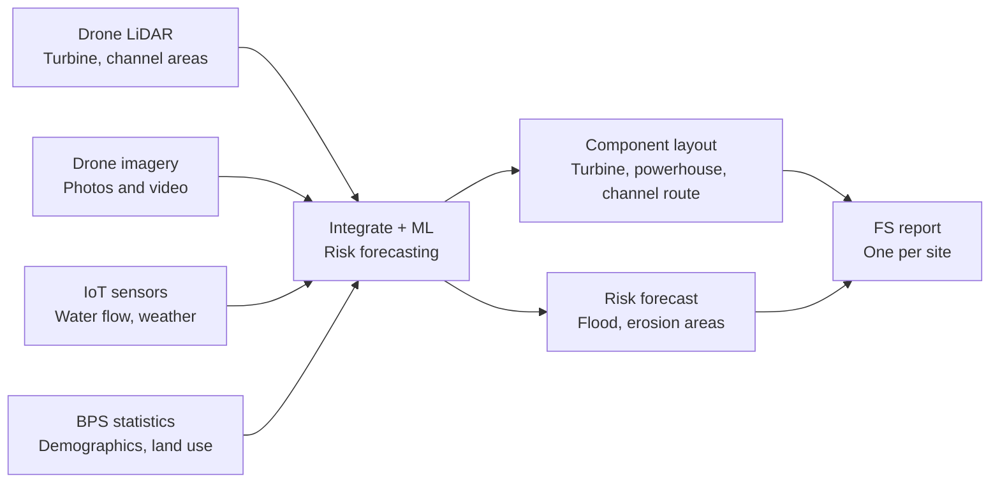

Drawing on the earlier study, operators flew drone-mounted LiDAR over the areas that decide a hydropower layout: potential turbine spots, powerhouse locations, and channel routes. LiDAR captures detailed elevation data, including the ground beneath vegetation. We processed it into topographic maps, 3D models, and digital elevation models (DEMs) for each site, and high-resolution drone photos and video added visual context.

IoT devices such as water-flow sensors and weather stations recorded water levels, flow rates, and weather patterns. BPS (Statistics Indonesia) data added local demographics, land use, and environmental conditions.

Machine learning then combined the terrain, water, weather, and statistics data to forecast areas likely to flood or erode. With that in hand we chose turbine locations on water flow and terrain slope, channel routes to minimise energy loss, and powerhouse positions to suit the terrain and access. Each site's results went into its own feasibility report.

### What we delivered

For each of the four sites:

| Output | What it shows | Who uses it |
| --- | --- | --- |
| Feasibility report | Site suitability, recommended layout, risks, and mitigation | Developer's decision-makers |
| Recommended component locations | Where the turbine, powerhouse, and water channel should go, and why | Design engineers |
| Topographic maps and DEMs | Bare-earth terrain from LiDAR, including under forest cover | Engineers |
| 3D models | The site in three dimensions, for layout planning and communication | Engineers and stakeholders |
| Risk maps | Forecast flood- and erosion-prone areas | Engineers and planners |
| Interactive maps | All layers for the site in one browsable view | All stakeholders |

### Benefits

- Four out of four sites built. Every site we studied went on to construction, so the feasibility work fed into actual investment decisions.
- LiDAR sees through forest canopy to the ground, so we chose component locations on measured elevation data rather than estimates.
- Focusing drone LiDAR on the areas that decide the layout kept data collection fast and affordable at remote sites.
- One method across four sites let the developer compare them side by side.
- Machine learning forecast flood- and erosion-prone areas while design changes were still cheap.
- The approach developed for an earlier minihydro study carried over to four new sites, and it can carry over again.

### Lessons learned

[DRAFT: generated from the portfolio; edit anything that doesn't match your experience]

The earlier minihydro study taught us where layout decisions are actually made: around potential turbine spots, powerhouse locations, and channel routes. We concentrated LiDAR on those areas instead of scanning everything at the same density, which saved time and cost at sites that are expensive to reach.

Water-flow sensors and weather stations gave valuable current measurements. But a deployment inside a 12-month contract can't capture year-to-year variation in river flow, so sensor data is most useful alongside longer-term records.

Four sites on three islands meant mobilising teams and equipment, finding power and connectivity, and timing fieldwork around weather. Planning those campaigns carefully mattered as much as the analysis. BPS data on population and land use added the social side that terrain data can't show, such as settlements and land use near the planned infrastructure.

Next time we would do three things differently.

1. Standardise the site data package from day one, so every site's outputs follow the same structure and comparisons are simple.
2. Deploy sensors as early and as long as possible, and combine them with any long-term flow records available for each river.
3. Check machine learning risk outputs with local knowledge, such as residents' accounts of past floods, before relying on them.

### To confirm before publishing

- [ ] Which IoT sensors were deployed, and for how long
- [ ] Review the [DRAFT] lessons learned
- [ ] Year, team size, and your exact role
- [ ] Whether the project can be described publicly without the developer's name
- [ ] Any images you're allowed to publish

### Site metadata

```yaml
title: "Hydropower Feasibility Studies Across Four Remote Sites"
lang: en
translationKey: hydropower-four-site-feasibility
proof: { value: "4 of 4", label: "Hydropower sites built", quote: "Four out of four sites built." }
sector: energy
secondarySectors: []
client: "A hydropower developer"
location: "Kapuas Hulu, Lampung, and Poso, Indonesia"
year: null            # TO CONFIRM
role: "Contract and programme manager"
methods: [drone-lidar, drone-mapping, iot-sensors, official-statistics, flood-erosion-forecasting]
outcome: "Feasibility studies for four hydropower sites in 12 months; all four proceeded to construction"
summary: "Drone LiDAR, field sensors, and machine learning informed feasibility studies at four remote hydropower sites, all of which went on to construction."
featured: true
comments: true
map: false
draft: true
regions:
  - { name: "Kapuas Hulu", lon: 112.8, lat: 0.8 }
  - { name: "Lampung", lon: 105.0, lat: -5.0 }
  - { name: "Poso", lon: 120.75, lat: -1.4 }
```

---

## 5. Landslide Early Warning System for Minihydro Power Plants

We built a landslide early warning system for an operator of multiple minihydro power plants. Drone surveys set a detailed baseline once or twice a year; between baselines, satellite data, IoT sensors, and the plants' own SCADA data feed a Random Forest model. Every day it reports which areas are most likely to be hit by a landslide, how far a slide could reach, and which assets are at risk, so field operators can check and act. We designed it with the client's engineers and operators, trained their staff after launch, and kept maintaining and improving it.

### At a glance

| | |
| --- | --- |
| **Sector** | Energy (secondary: Environment & Pollution) |
| **Location** | [TO CONFIRM: regions or number of plants covered] |
| **Client** | An operator of multiple minihydro power plants |
| **Scope** | Design, build, deployment, training, and ongoing maintenance of a landslide early warning system |
| **Year** | [TO CONFIRM] |
| **My role** | [TO CONFIRM] |
| **Team** | Our team: 2 spatial data scientists, 1 programmer, 1 GIS engineer. Client side: about 20 engineers and field operators contributing knowledge and feedback |
| **Data** | Periodic drone baselines; InSAR ground movement, hyperspectral imagery, orthophotos, weather forecasts, wind data, and geological fault lines; rain gauges; SCADA water level and flow |
| **Methods** | Drone baselines once or twice a year, satellite monitoring between baselines, deep learning land cover classification, Random Forest landslide forecasting, web-based early warning dashboard |
| **Stack** | QGIS, Python (spatial processing, machine learning, deep learning, Django), Node, Leaflet, PostgreSQL with PostGIS |
| **Deliverables** | Daily landslide risk reports, early warning dashboard, operator training, ongoing maintenance and improvement |

### The challenge

Minihydro plants sit in steep river valleys, exactly where landslides happen. A slide can block an intake, break a water channel, damage a powerhouse, or cut the only access road. Generation stops and staff are at risk. The operator runs many plants and came with three questions.

1. Where and when is a landslide likely? Knowing which slopes are dangerous wasn't enough. Operators needed a warning when conditions turned risky.
2. Can existing data help? The plants already produce operational data through SCADA, but it had never been used for hazard monitoring.
3. Will people use it? A warning system works only if operators at every plant trust it and know how to act on it, long after the project ends.

### How we did it

Detailed drone baselines are expensive to repeat at remote plants, so the system uses them sparingly and lets satellite data carry the monitoring in between. All data goes into one spatial database, a Random Forest model turns it into a daily risk report, and field operators confirm and act on it. Their feedback flows back into the model.

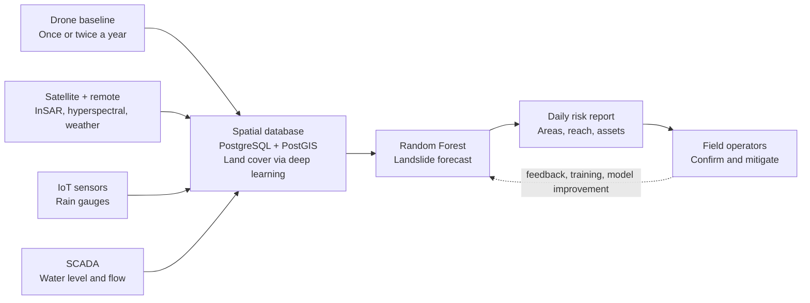

We started with the people who know the sites. Working with the client's engineers and operators, alongside other specialists, we went through past landslides, the most exposed assets, and what a useful warning should look like.

Next came the drone baseline. Once or twice a year, drone surveys capture a detailed picture of the terrain around each plant. Between baselines, remote data carries the monitoring: InSAR for ground movement, hyperspectral imagery, orthophotos, weather forecasts, wind data, and geological fault lines. Rain gauges in the field add local rainfall, and the plants' SCADA systems add water level and flow. The team doesn't need to visit every site often.

All of it was ingested into PostgreSQL with PostGIS and processed with QGIS and Python, so every reading is tied to a location and a time. A deep learning image classifier maps land cover from the imagery, and that map becomes one input to the forecast model.

A Random Forest model trained on the combined data forecasts which areas are most likely to be hit by a landslide, how far a slide could reach, and which plant assets fall within that reach.

A Django backend serves the forecast to a web dashboard built with Node and Leaflet. It produces a daily report of high-risk areas, likely impact extent, and assets at risk, which operators see on the dashboard and also receive as a dedicated report.

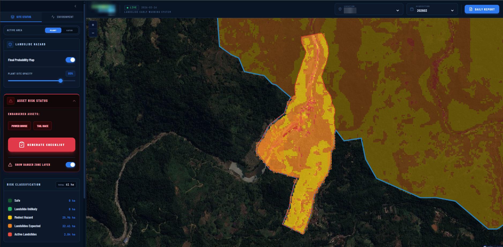

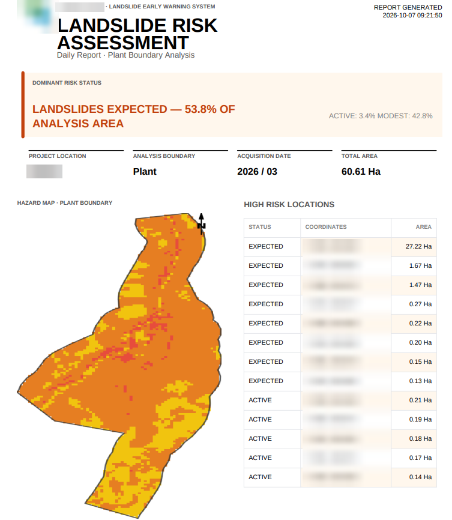

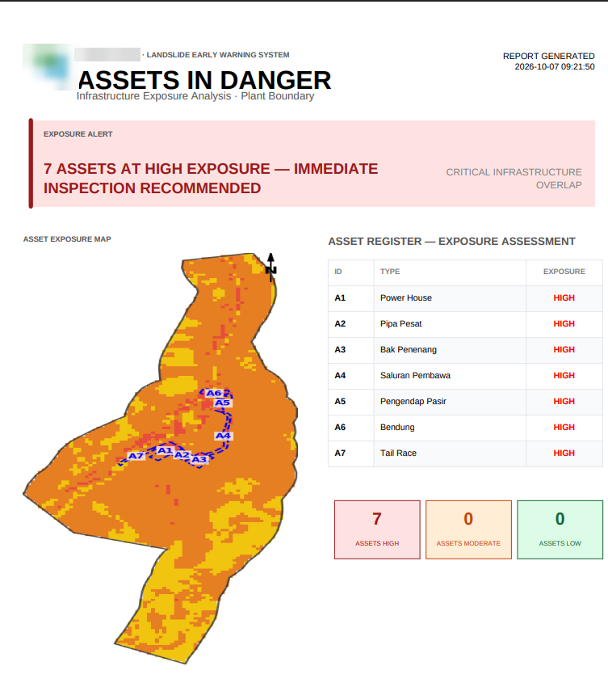

Field operators use the daily report to decide which areas to monitor. They confirm conditions on the ground and carry out mitigation where needed, such as covering slopes with geotextile or replanting vegetation.

After launch we trained the client's staff and kept maintaining the system, improving the model as new data and operator feedback came in.

### Technology stack

The whole system runs on open-source tools, so the client has no software licences to pay for.

| Layer | Tools | Role |
| --- | --- | --- |
| Spatial processing | QGIS, Python spatial libraries | Preparing and analysing drone, satellite, and terrain data |
| Deep learning | Python [TO CONFIRM: library] | Classifying land cover from imagery |
| Machine learning | Python, Random Forest [TO CONFIRM: library, for example scikit-learn] | Forecasting landslide areas, reach, and assets at risk |
| Database | PostgreSQL with PostGIS | Storing spatial, sensor, and SCADA data in one place |
| Backend | Python, Django | Data ingestion, model results, and the web API |
| Frontend | Node, Leaflet | The web map, dashboard, and daily report |

### What we delivered

| Output | What it does | Who uses it |
| --- | --- | --- |
| Daily landslide risk report | Lists the areas most likely to be hit, how far a slide could reach, and which assets are at risk | Field operators and plant managers |
| Web map and dashboard | Shows plants, risk areas, impact extent, sensor readings, and assets on one map | Operators and engineers |
| Field response workflow | Operators check flagged areas on the ground and mitigate, for example with geotextile or replanting | Field operators |
| Integrated database | Drone, satellite, IoT, and SCADA data in one spatial database | The client's technical team |
| Random Forest model | Learns the conditions that lead to landslides from the combined data | Runs inside the system |
| Operator training | How to read the daily report and act on it | Operators and engineers |
| Maintenance and improvement | Ongoing fixes, updates, and model improvements after launch | The client |

### Benefits

- Operators get a forecast every day: where a landslide is most likely, how far it could reach, and what it could hit. A hazard map alone doesn't say when.
- Drone baselines once or twice a year, with satellite monitoring in between, keep the system current without frequent trips to remote plants.
- The daily report sends field operators to the right slopes, where they confirm conditions and mitigate with geotextile or replanting.
- SCADA data the plants already collected became an input for hazard forecasting.
- We designed the system alongside the client's engineers and operators, so it fits how the plants run.
- Training, maintenance, and ongoing improvement after launch kept the system working and trusted.
- The stack is entirely open-source, which keeps running costs down and lets the client's team extend it.

### Lessons learned

[DRAFT: generated from what you described; edit anything that doesn't match your experience]

The client's engineers and operators knew things the sensors didn't: which slopes had moved before, which roads close in heavy rain, and what warning signs they watch for. We brought that knowledge in early. It shaped the model and made its warnings credible to the people receiving them.

SCADA records are designed to run a plant, not to study slopes. Using them alongside spatial data took work: aligning timestamps, handling gaps, and linking readings to locations.

Landslides are rare, and each plant sees few of them, which makes learning hard for a machine learning model that needs examples. We tuned the balance between false alarms and missed warnings with the operators, because too many false alarms and people stop listening. Random Forest also shows which inputs drive each forecast, which helps explain results to operators.

Training and ongoing maintenance were what turned a delivered system into one that is used. Each new event and each piece of operator feedback is a chance to improve the model.

What we'd do next:

1. Measure warning performance, such as how far ahead warnings come and how often they're false alarms, to show the system's value in numbers.
2. Keep a structured event log at every plant, so each landslide or near-miss becomes training data.
3. Add more ground sensors at the highest-risk slopes, where earlier signs of movement may show up.

### To confirm before publishing

- [ ] Machine learning and deep learning libraries used
- [ ] Number of plants and regions covered
- [ ] Review the [DRAFT] lessons learned
- [ ] Year and your role
- [ ] Any real warnings issued or events captured, if shareable
- [ ] Whether the project can be described publicly without the client's name
- [ ] Any screenshots of the dashboard you're allowed to publish

### Site metadata

```yaml
title: "Landslide Early Warning System for Minihydro Power Plants"
lang: en
translationKey: landslide-early-warning-minihydro
proof: { value: "Daily", label: "Landslide risk report", quote: "Every day it reports" }
sector: energy
secondarySectors: [environment-pollution]
client: "An operator of multiple minihydro power plants"
location: "Indonesia"   # TO CONFIRM
year: null            # TO CONFIRM
role: null            # TO CONFIRM
team: 4               # plus about 20 client engineers and field operators
methods: [drone-baseline, insar, hyperspectral, rain-gauges, scada-integration, deep-learning-land-cover, random-forest]
stack: [qgis, python, django, node, leaflet, postgresql, postgis]
outcome: "Daily landslide risk reports showing likely areas, impact extent, and assets at risk, acted on by field operators"
summary: "Drone baselines, InSAR, rain gauges, and SCADA data feed a Random Forest model that gives minihydro operators a daily landslide risk report."
featured: true
comments: true
map: false
draft: true
cover: main.png
```

---

## 6. Mapping Illegal Mining to Protect Communities and Nature

Illegal mining strips forests, erodes hillsides, and contaminates the rivers that nearby communities rely on for water, farming, and food. In three regions of Indonesia, we mapped mining activity to find out how many mines were operating illegally and what harm they were doing to people and nature. Drone surveys located every mining site, comparison with permit areas identified the illegal ones, and soil and water sampling measured the damage. The result showed where communities and ecosystems were most at risk, and where restoration should start.

### At a glance

| | |
| --- | --- |
| **Sector** | Mining (secondary: Environment & Pollution, Forestry & Land Governance) |
| **Location** | Buton (Southeast Sulawesi), Malang (East Java), and Kuningan (West Java), Indonesia |
| **Client** | A national environmental agency |
| **Purpose** | Protecting communities and ecosystems from the effects of illegal mining |
| **Scope** | Mapping mining activity, identifying illegal mines, and assessing the danger to land, water, and people in three regions |
| **Year** | [TO CONFIRM] |
| **My role** | [TO CONFIRM] |
| **Data** | Drone imagery (high-resolution RGB and multispectral), mining permit areas, soil and water samples |
| **Methods** | Drone photogrammetry, land classification, comparison with permit areas, environmental sampling, risk mapping |
| **Deliverables** | Inventory of illegal mines, land classification maps, danger maps, 3D models, restoration and enforcement recommendations |

### The challenge

Illegal mining is hard to regulate because it's hard to see. Sites are often small, scattered, and in remote or hilly terrain, and they appear and move faster than ground inspections can follow. The agency needed answers to two questions in three very different regions.

1. How many illegal mines are there, and where? Without an accurate count and location for each site, enforcement and restoration can't be planned.
2. How dangerous are they? Mining without controls can strip forest, destabilise slopes, and contaminate rivers that communities depend on. The agency needed to know where the damage was worst and what kind it was.

Each region mined something different (nickel, limestone and marble, and gold), so the dangers differed too. One method had to work across all three.

Behind the numbers are villages downstream of a contaminated river, farmers whose fields depend on clean water, and forests that hold hillsides together. Mining supports local economies, so the aim was to bring it under rules that protect the environment and the communities around it.

### How we did it

The method ran on two tracks: one to find and count illegal mines, and one to measure the damage they cause.

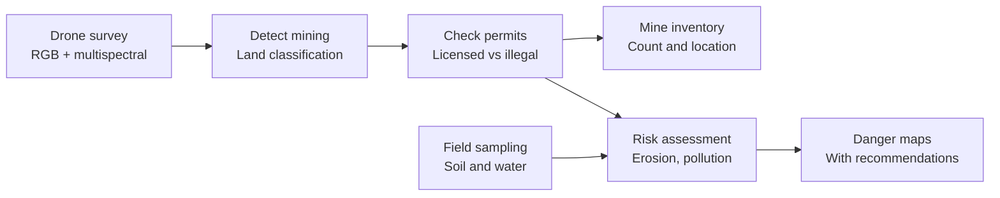

Drones with high-resolution and multispectral cameras flew over the mining areas in all three regions, capturing the terrain, vegetation, and water bodies. The imagery was processed into orthomosaic maps and 3D models.

Land classification then separated forest, farmland, water, and mining sites, which showed every area disturbed by mining. [TO CONFIRM: manual interpretation, AI classification, or both]

We compared each detected mining site with licensed mining permit areas. Sites operating outside any permit were counted as illegal and added to the inventory with their location and size.

Field teams collected soil and water samples around the mining areas to measure contamination and identify its sources. Combining the imagery, terrain, and sample results showed where mining was causing deforestation, erosion, water disruption, or contamination, and how severe each was.

Each region received danger maps and recommendations on where to enforce, where to improve waste management, and where to restore land and forest.

### Three regions, three kinds of danger

The same method turned up a different problem in each region.

| Region | What was mined | Illegal mines found | Main danger found |
| --- | --- | --- | --- |
| Buton, Southeast Sulawesi | Nickel | [TO CONFIRM: number] | Deforestation and soil erosion around mining sites |
| Malang, East Java | Limestone and marble | [TO CONFIRM: number] | Disruption of local water systems |
| Kuningan, West Java | Gold | [TO CONFIRM: number] | Contamination of nearby rivers, threatening communities and ecosystems |

These dangers compound. Erosion on cleared slopes raises the risk of landslides, and contaminated rivers carry the damage far beyond the mine itself, into farmland and drinking water downstream.

### Who the work protects

| Who or what | How illegal mining threatens it | How the mapping helps |
| --- | --- | --- |
| Downstream communities | Contaminated rivers affect drinking water, fishing, and health | Shows which rivers and villages are at risk, so monitoring and clean-up can be prioritised |
| Farmers | Polluted water and eroded soil damage fields and harvests | Identifies affected farmland and the sources of contamination |
| Forests and habitats | Clearing for mining removes forest and fragments habitat | Measures forest loss and shows where reforestation is most needed |
| Hillsides and soils | Stripped slopes erode and can become unstable | Locates eroding areas for soil restoration and slope protection |
| Water systems | Mining can disrupt how water flows through an area | Maps disruption so water systems can be restored |

### What we delivered

| Output | What it shows | Who uses it |
| --- | --- | --- |
| Illegal mine inventory | Count and location of every illegal mining site in each region | Enforcement and regulatory teams |
| Land classification maps | Forest, farmland, mining sites, and water bodies | Planners and regulators |
| Danger maps | Where erosion, water disruption, and contamination are worst | Environmental managers |
| Soil and water findings | Measured contamination at sampled locations | Environmental and public health teams |
| Orthomosaics and 3D models | Current, measurable views of each mining area | Technical teams |
| Recommendations | Priority areas for enforcement, waste management, reforestation, and land restoration | Agency decision-makers |
| Reports and interactive maps | All findings in one place for each region | All stakeholders |

### Benefits

- The maps showed which rivers, villages, and farmland were exposed to mining damage, so protection could start where people were most affected.
- Measured forest loss and erosion showed where reforestation and soil restoration were most needed.
- The agency knew how many illegal mines were operating and exactly where, instead of relying on reports and guesswork.
- Combining imagery with soil and water samples showed which sites were doing the most harm, so action could start there.
- Dated, georeferenced evidence supported decisions that balance the economic value of mining with protecting people and nature.
- The same approach worked for nickel, limestone, and gold mining, so results could be compared across regions.

### Lessons learned

[DRAFT: generated from the portfolio; edit anything that doesn't match your experience]

Drone imagery showed where mining was happening and how much land it had disturbed. It couldn't show what was in the water. Pairing aerial mapping with soil and water sampling turned a map of activity into evidence of danger.

Separating legal from illegal mining depends on accurate permit maps. Where permit boundaries were outdated or imprecise, the comparison needed care and field checks. [CONFIRM: whether this was a real issue]

Small mines open, move, and close fast. An inventory is a snapshot, so repeat surveys are needed to keep it useful.

Teams working near active, unlicensed operations face safety and social risks, so we planned access with local authorities. [CONFIRM: whether this matched your experience]

What we'd do next:

1. Repeat surveys on a schedule to track new sites and confirm closures.
2. Use satellite change detection between drone surveys to spot new clearings early.
3. Link danger maps to downstream communities and water users, so the people at risk are clear.

### To confirm before publishing

- [ ] The number of illegal mines found in each region (or a total, if per-region counts are sensitive)
- [ ] How mining sites were detected: manual interpretation, AI classification, or both?
- [ ] Which soil and water parameters were measured
- [ ] Whether the dangers listed per region are accurate
- [ ] Any community or conservation outcome you can share, for example restoration that followed or communities consulted
- [ ] Review the [DRAFT] lessons learned
- [ ] Year, team size, and your role
- [ ] Whether the project can be described publicly without the agency's name; since this touches enforcement, keep site locations general
- [ ] Any images you're allowed to publish

### Site metadata

```yaml
title: "Mapping Illegal Mining to Protect Communities and Nature"
lang: en
translationKey: illegal-mining-communities-nature
sector: mining
secondarySectors: [environment-pollution, forestry-land-governance]
tags: [conservation, communities, illegal-mining, water-quality]
client: "A national environmental agency"
location: "Buton, Malang, and Kuningan, Indonesia"
year: null            # TO CONFIRM
role: null            # TO CONFIRM
methods: [drone-photogrammetry, multispectral, land-classification, permit-overlay, soil-water-sampling, risk-mapping]
outcome: "Illegal mines counted and mapped across three regions, showing where communities and ecosystems were most at risk"
summary: "Drone mapping, permit comparison, and soil and water sampling revealed illegal mines in three regions and the harm they posed to communities and nature."
featured: true
comments: true
map: false
draft: true
regions:
  - { name: "Buton", lon: 122.9, lat: -5.3 }
  - { name: "Malang", lon: 112.63, lat: -7.98 }
  - { name: "Kuningan", lon: 108.48, lat: -6.98 }
```

---
## 7. Forecasting Belitung's Coastline

Between 1990 and 2024, Belitung Island lost about 3,800 hectares of land. We measured how its coastline changed over those 34 years using open satellite data, then worked out what was driving the change (sea-level rise, mangrove loss and tin mining) and projected where the coast is likely to be by mid-century under three climate scenarios. The result shows which stretches of coast face the highest risk, along with the communities and ecosystems on them.

### At a glance

| | |
| --- | --- |
| **Sector** | Environment & Pollution (secondary: Mining) |
| **Location** | Belitung Island, Bangka Belitung, Indonesia |
| **Client** | [TO CONFIRM: client type, or self-initiated study] |
| **Scope** | Historical coastline change 1990–2024 and a coastline forecast to 2045 |
| **Year** | [TO CONFIRM] |
| **My role** | [TO CONFIRM] |
| **Data** | Landsat 5/7/8/9, Sentinel-2, Sentinel-1 SAR, Copernicus DEM, Global Mangrove Watch, IPCC AR6 sea-level projections |
| **Methods** | Google Earth Engine shoreline extraction (MNDWI), tidal correction, trend analysis across six epochs, Bruun Rule sea-level retreat, driver analysis |
| **Tools** | Google Earth Engine, CoastSat with the FES2014 tide model, QGIS with DSAS |
| **Deliverables** | Land change analysis, projected shoreline and change rasters, coastal risk maps under three scenarios, recommendations |

### The challenge

Belitung's coast is under several pressures at once. Sea levels are rising and waves wear away exposed shores. Mangroves that once held the coastline together are disappearing, and decades of tin mining have reshaped the land and the seabed. Some stretches lose land, while others gain it through sedimentation or reclamation.

Coastal planners needed answers to three questions:

1. How much has the coast changed, and where? An island-wide total hides the local story. Planners need to know which stretches are retreating and how fast.
2. What is driving it? Climate, mangrove loss and mining call for very different responses.
3. Where will the coast be in the coming decades? Past trends alone can't capture accelerating sea-level rise, so the forecast had to combine history with physics.

The people along that coast live in villages and fishing communities, and they depend on the mangroves and coastal ecosystems that are changing.

### How we did it

The pipeline runs on open satellite data and open tools. The first half measures the past and the second half projects the future.

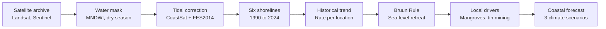

1. Build cloud-free composites. The Landsat archive (Landsat 5, 7, 8 and 9) gives the long record back to 1990. From 2014, Sentinel-2 adds sharper optical imagery and Sentinel-1 radar sees through cloud. In Google Earth Engine, dry-season composites keep cloud interference down.

2. Separate water from land. For each epoch, the Modified Normalised Difference Water Index, `MNDWI = (Green − SWIR) / (Green + SWIR)`, is positive over water and negative over land. Thresholding at zero gives a clean land and water mask.

3. Correct for tides. CoastSat with the FES2014 tide model standardises each shoreline to mean sea level, so tide differences between images aren't mistaken for erosion.

4. That gives six corrected shorelines spanning 1990 to 2024.

5. Measure the trend. Each location's rate of change is fitted across the six epochs with linear regression. In the per-pixel version, every pixel gets a signed distance from the coast (positive inland, negative at sea), and the slope of that distance over time gives its rate. In the transect version, QGIS with the Digital Shoreline Analysis System (DSAS) casts transects every 100 m around the island and calculates a linear regression rate for each, classifying the coast as eroding, stable, or accreting. [TO CONFIRM: which version the final forecast used]

6. Add sea-level rise with the Bruun Rule. Past trends can't capture accelerating sea-level rise, so the Bruun Rule converts it into shoreline retreat: `R = (SLR × L) / (B + d)`. SLR comes from IPCC AR6 projections for Belitung, L is the active profile length (500 m by default), B is berm height from the Copernicus DEM, and d is closure depth (5 m by default). Low, flat beaches retreat much more than steep ones for the same rise.

7. Account for local drivers. Historical mangrove extent from Global Mangrove Watch, refined with Sentinel classification, was compared with erosion rates. The Sentinel-2 red band served as a turbidity proxy to trace sediment plumes from tin mining.

8. Project forward. After advancing the baseline to today, the projected position is `sd_future = currentSD + (rate × years) − R`, run under three IPCC scenarios: SSP1-2.6, SSP2-4.5, and SSP5-8.5. Where the projected distance crosses zero is the projected shoreline.

### What we found

#### Land change, 1990–2024

| Measure | Result |
| --- | --- |
| Net change in land area, 1990–2024 | −3,811 ha |
| Average change per five-year period | −544 ha |
| Largest loss | −6,261 ha (2020–2024) |
| Largest gain | +4,979 ha (2015–2020) |

The net figure hides large swings. Periods of gain, likely from reclamation or sediment from mining, were followed by sharper losses, consistent with natural forces such as abrasion and rising seas working alongside human activity.

#### Where the risk is highest

The highest-risk erosion zones sit along the mined eastern coast and along stretches where mangroves have degraded. Where mangroves had retreated, comparing their historical extent with erosion rates showed rapid destabilisation. Sediment plumes in the satellite imagery traced the footprint of tin mining and its link to erosion. Local factors like these speed up the baseline erosion.

#### The forecast

Under three climate scenarios (low, middle, and high emissions), the forecast classifies each stretch of coast as high risk, medium risk, low risk, or accreting. [ADD: headline forecast numbers, for example projected land loss or retreat distance per scenario, if available]

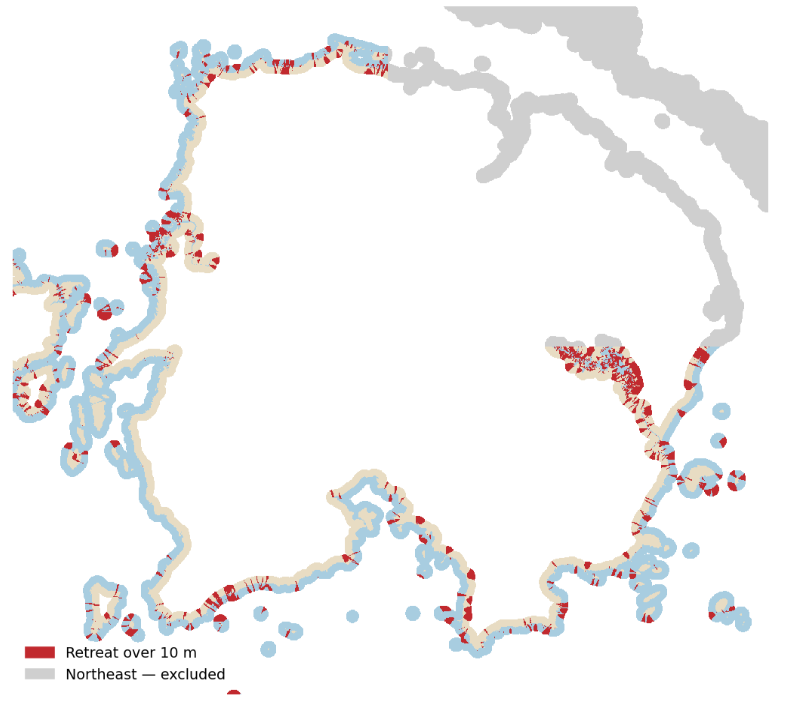

### What we delivered

| Output | What it shows | Who uses it |
| --- | --- | --- |
| Land change analysis, 1990–2024 | Net and per-period gains and losses of land | Planners and policymakers |
| Six historical shorelines | Where the coast stood at each epoch, corrected for tides | Coastal scientists and planners |
| Erosion and accretion rates | How fast each stretch of coast is moving, and in which direction | Coastal engineers |
| Driver analysis | Links between erosion, mangrove loss, and tin mining | Environmental managers |
| Forecast raster (GeoTIFF) | Four bands: projected land or sea, projected signed distance, change in metres, historical rate | GIS analysts |
| Coastal risk maps | High, medium, and low risk and accreting stretches under three climate scenarios | Planners, communities, decision-makers |
| Recommendations | Mangrove rehabilitation, coastal green belts, oversight of post-mining reclamation, satellite monitoring, coastal community education | Local government and agencies |

### Benefits

- The risk maps show which stretches of coast, and which villages along them, are likely to lose ground in the coming decades.
- Linking erosion to mangrove loss supports the case for rehabilitation, which protects both the coast and the ecosystems it supports.
- Tracing sediment plumes and their link to erosion gives oversight of mining and post-mining reclamation something to work from.
- Combining measured trends with sea-level rise physics gives a more credible forecast than either alone.
- Three climate scenarios let planners prepare for a range of outcomes instead of a single guess.
- The analysis uses only open satellite data and open tools, so it can be repeated as new imagery arrives.

### Lessons learned

[DRAFT: generated from the project materials; edit anything that doesn't match your experience]

A satellite image taken at high tide shows a narrower beach than one taken at low tide. Without tidal correction, much of the apparent change would have been tide, not erosion.

Tropical cloud cover rules out many images. Dry-season composites and cloud-penetrating radar made consistent epochs possible.

A net loss of about 3,800 ha sounds modest for an island, but it hides swings of several thousand hectares between periods and severe local losses. Per-location rates are what planners can act on.

A trend line assumes tomorrow looks like yesterday, but sea-level rise is accelerating. Adding the Bruun Rule brought physics into the forecast.

The Bruun Rule was developed for sandy beaches and relies on simplifying assumptions. On muddy, mangrove-lined or mined coasts, its results should be read as indicative, not exact.

What we'd do next:

1. Validate the forecast against new shorelines as imagery arrives each year.
2. Field-check high-risk stretches with local communities and coastal surveys.
3. Model mangrove rehabilitation scenarios to show how much protection restoration could buy.

### To confirm before publishing

The three source documents don't fully agree, so please settle these first:

- [ ] Forecast year: 2045 (method deck) or 2050 (forecast deck)?
- [ ] Trend method used in the final forecast: per-pixel signed distance, transects every 100 m with DSAS, or both?
- [ ] Driver adjustments: were mangrove and mining adjustments actually applied per transect in the forecast, or only analysed?
- [ ] Whether the land change figures (−3,811 ha and so on) come from the same satellite pipeline or an earlier analysis
- [ ] Headline forecast results per scenario, if available
- [ ] Client or purpose (commissioned, partnership, or self-initiated), year, team, and your role
- [ ] Images: don't reuse the NotebookLM slides as they are; their map coordinate labels are wrong. Export clean maps from QGIS instead
- [ ] Review the [DRAFT] lessons learned

### Site metadata

```yaml
title: "Forecasting Belitung's Coastline"
lang: en
translationKey: belitung-coastline-forecast
proof: { value: "34 years", label: "Of coastline change measured", quote: "over those 34 years" }
sector: environment-pollution
secondarySectors: [mining]
tags: [coastal-change, climate, sea-level-rise, mangroves, google-earth-engine]
client: null          # TO CONFIRM
location: "Belitung Island, Indonesia"
year: null            # TO CONFIRM
role: null            # TO CONFIRM
methods: [mndwi, tidal-correction, shoreline-trend, bruun-rule, ssp-scenarios, driver-analysis]
stack: [google-earth-engine, coastsat, qgis, dsas]
outcome: "34 years of coastline change measured and a scenario-based coastal risk forecast for Belitung"
summary: "Open satellite data, tidal correction, and the Bruun Rule measured Belitung's coastline change since 1990 and forecast its coastal risk under three climate scenarios."
featured: true
comments: true
map: false
draft: true
regions:
  - { name: "Belitung", lon: 107.9, lat: -2.85 }
```

---

# Articles

Practitioner articles live here alongside the case studies for now. On the site they go in `src/content/posts/`, not `projects/`.

---

## A1. Building the App Was Easy. Getting People to Use It Took Three Months.

*Part 1 of a series on digitalising a construction company: lessons from introducing a first digital tool.*

The EPC company I worked for was founded in 1981, and when I was asked to introduce digitalisation, most work still ran on paper and experience. Construction has a reputation as the last industry to adopt new technology, and this company fit it.

Progress tracking was the clearest case. To decide how far along a task was, the chief supervisor used his or her own judgement. No data sat behind the number, only experience and a feel for the site.

Those estimates didn't stay on site. They fed into proposals for new projects, so an educated guess about one job became the basis for pricing the next, and any error carried into a commercial commitment.

### Why a timesheet app came first

We started with a timesheet app that records who worked on which task and for how long. That gave us data on effort and progress to set alongside the supervisor's judgement.

I picked it on purpose. The app was small enough to build quickly and easy to explain, and its data would feed better progress tracking and, later, more accurate proposals. In a company new to digital tools, the first project also has to earn trust for the ones after it.

### Getting people to use it

Building the app was the easy part. Getting people to use it was much harder.

I should have expected that, but you forget it when you're busy building. A timesheet app asks people to change a daily habit and to make their work visible when it wasn't before. For staff who'd never used one, every small hassle was a reason to skip it. For a supervisor whose judgement had always been the final word, data can feel like a challenge to that authority.

Better code doesn't fix that, so we planned adoption as a main part of the project. It doesn't happen on its own after launch.

### Two rules we followed

Looking back, two rules got the rollout through.

#### 1. Leave no excuse not to use it

When an app is slow, confusing, or asks for too much, people don't argue with it. They stop using it and blame the app. We treated usability as the way to remove that excuse: the app had to be quick and obvious enough that nobody could credibly say it was too hard.

[ADD: one or two concrete examples, such as fields you removed, how long an entry took, or how you tested it with field staff]

#### 2. Make it produce something management wants

Staff using it is not enough. If management can't see what the app gives them, support fades and the app dies. Early on, we made the data produce something useful for management, so leaders could see why the company needed it and kept backing it.

[ADD: what that output was, for example a progress report, a man-hour summary, or a dashboard, and how management used it]

### Six months from launch to habit

People didn't adopt it at launch. It took months of steady effort.

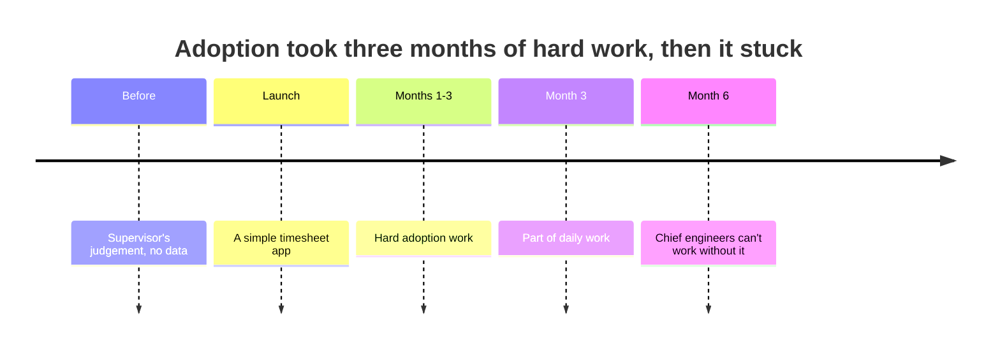

The first three months were painful. [ADD: what that looked like, for example missed entries, pushback, or fixes to the app]

Around the third month, things changed. The app stopped being a new tool people were told to use and became part of how the company ran.

By the sixth month, the chief engineers couldn't work without it. One of them complained because someone else wasn't using the app properly. The people whose judgement the data was meant to support were now enforcing it.

### If you're starting a digital transformation

1. Start with something simple that you can finish. The first project earns the trust you need for the ones after it.
2. Plan time, people, and attention for adoption. For us, that was three months of hard work after the app was ready.
3. Take away every excuse. If the app is easy to use, people can't blame it when they don't want to change.
4. Show management the value early. If leaders can't see what they get, their support won't last long enough for people to adopt it.
5. Watch for users who enforce it themselves. For us, the sign was a senior user complaining when someone else didn't use the system properly. A launch date doesn't tell you that.

### To add before publishing

- [ ] Concrete usability choices (the two [ADD] notes above)
- [ ] What the app produced for management
- [ ] What made months 1 to 3 painful: resistance, bugs, missing data, or something else?
- [ ] What changed around month 3 to make it stick
- [ ] Any before/after result, for example how close progress estimates or proposals came to actual figures (only if shareable)
- [ ] Year, team size, and whether the app was built in-house
- [ ] Whether to name the company, or keep it as "an Indonesian EPC company"
- [ ] Which digital tools followed the timesheet app (a good link to future articles)

### Site metadata

```yaml
title: "Building the App Was Easy. Getting People to Use It Took Three Months."
lang: en
translationKey: timesheet-app-adoption
categories: [digital-transformation]
tags: [lessons-learned, change-management, adoption, construction]
series: digitalising-construction
seriesOrder: 1
summary: "Rolling out a timesheet app in a construction company: adoption was the hard part, and this covers what made it stick."
published: null
updated: null
comments: true
map: false
draft: true
```

---
## A2. KPI Dashboards for a Construction Company's Leadership

*Part 2 of a series on digitalising a construction company. Part 1 covered how a simple timesheet app became part of daily work.*

Sooner or later, every leadership team asks for a dashboard. They want to see how the company is doing at a glance, and they want it to be right.

A dashboard can only show data that already exists, and in most traditional companies that data doesn't exist yet, or it lives in spreadsheets nobody fully trusts. Build the dashboard first and you get a polished screen with weak numbers behind it. Leaders notice quickly, and they stop looking.

At the EPC company where I led digitalisation, we built the leadership dashboards last. By then the data was already flowing in every day, because people were using our app for their daily work.

### From a timesheet app to an enterprise app

The timesheet app didn't stay a timesheet app. Once it was part of daily work, we kept adding modules to the same app: leave requests, accounting, chat, an information broadcaster, and more. [ADD: other modules, and roughly when each was added]

Every module lived in one app with one database. Employees, projects, and time were recorded once and reused everywhere, instead of being typed again into separate systems.

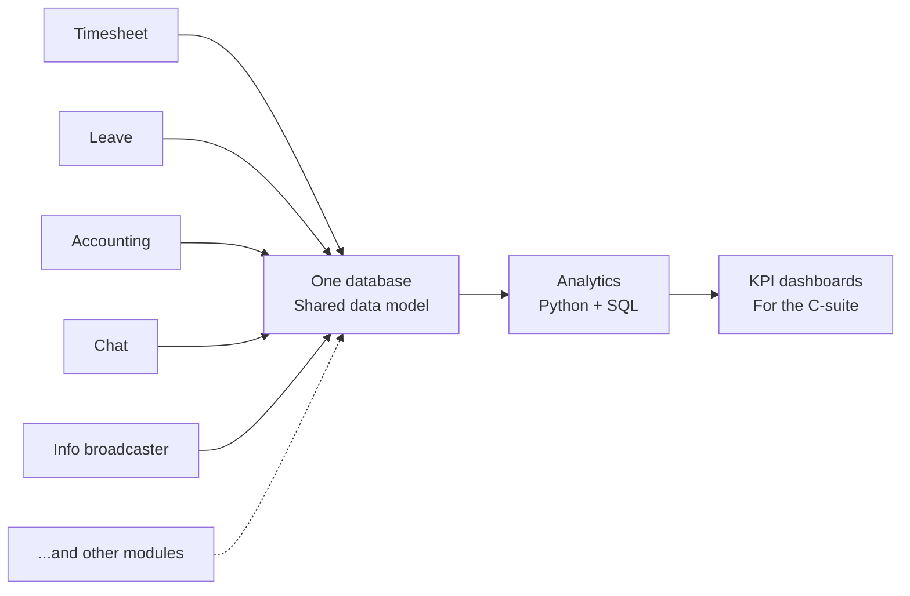

The leadership dashboards sat at the end of this chain. The data was already in the database, so they needed no separate collection effort.

### What the dashboards showed

Using Python and SQL on top of the app's database, we built analytics, KPI dashboards, and operational forecasts for the leadership team.

[CONFIRM: these are suggested KPIs based on the app's modules. Keep only the ones that were actually on the dashboards, and add any that are missing.]

The dashboards tracked KPIs such as these:

| KPI | Built from | The question it answers |
| --- | --- | --- |
| Actual vs planned man-hours | Timesheet, project plan | Is each project using more or less effort than planned? |
| Progress by recorded effort | Timesheet | How far along is each task, based on data rather than judgement? |
| Labour cost vs budget | Timesheet, accounting | Is labour spending on track for each project? |
| Utilisation rate | Timesheet, leave | How much of people's available time goes to project work? |
| Available capacity | Leave, timesheet | Who is free to take on work in the coming weeks? |
| Overtime hours | Timesheet | Where are teams overstretched? |
| Timesheet completion rate | Timesheet | Are people filling in the app on time, so the other numbers can be trusted? |
| Estimate accuracy | Timesheet, past proposals | How close were proposal estimates to the effort projects actually took? |

Each module answers one question on its own. Together they answer the questions leadership asks. Timesheet data shows how effort is spent, leave data shows who is available, and accounting data shows what it all costs, so progress, capacity, and cost can sit side by side, all from the same source. [CONFIRM: which of these combinations you actually used]

Part 1 paid off here. Progress had once been the chief supervisor's judgement call, and the same guesses fed into proposals. With months of timesheet data behind them, both progress reporting and proposal estimates could rest on recorded effort. [ADD: whether proposals or estimates measurably improved, if shareable]

### Working with leadership

I worked directly with the C-suite on what the dashboards should show. An executive dashboard isn't a smaller operational report. It has to answer the questions they act on, and they need to trust where every number comes from.

Trust was easier to earn here than usual. The numbers weren't assembled from spreadsheets for the occasion. They came straight from the app staff used every day, and when a figure looked surprising, we could trace it back to the entries behind it.

[ADD: how you worked with the C-suite, for example how you chose the KPIs, how often they reviewed the dashboards, and one moment when a dashboard changed a decision]

### What I'd tell anyone building executive dashboards

1. Build the data habit before the dashboard. A dashboard is only as good as the data people enter every day, so get an everyday tool adopted first, then build the view on top of it.
2. Grow one platform instead of adding separate tools. Each module we added lived in the same app and database, so every new feature made the data richer instead of creating another silo.
3. Give people reasons to open the app daily. Modules people need anyway, such as leave requests, keep the app part of the routine, and steady use keeps the data complete. [CONFIRM: whether chat and the information broadcaster played this role]
4. Make every number traceable. Executives trust a figure when they can see where it came from, and data from the daily work tool makes that possible.
5. If leadership asks for a dashboard on day one, the answer is often to make sure the data exists first.

### To add before publishing

- [ ] Review the suggested KPIs: keep the real ones, remove the rest, and note which one leadership watched most
- [ ] Which module combinations were actually used (timesheet, leave, accounting, others)
- [ ] What the operational forecasts predicted
- [ ] How you worked with the C-suite, and one decision a dashboard changed
- [ ] Whether chat and the information broadcaster kept people using the app daily
- [ ] The order modules were added, and roughly over how long
- [ ] Any measurable result, for example better proposal accuracy (only if shareable)
- [ ] Dashboard tooling, if not built fully in Python (for example a BI tool)

### Site metadata

```yaml
title: "KPI Dashboards for a Construction Company's Leadership"
lang: en
translationKey: kpi-dashboards-enterprise-app
categories: [digital-transformation]
tags: [kpi, dashboards, enterprise-app, lessons-learned, construction]
series: digitalising-construction
seriesOrder: 2
summary: "How a timesheet app grew into an enterprise app, and why the leadership dashboards built on it were trusted."
published: null
updated: null
comments: true
map: false
draft: true
```

---

## A3. Data Governance Without the Bureaucracy

*A practical guide for organisations whose decisions increasingly depend on data, from enterprise apps to drone surveys and AI models.*

Every digital transformation eventually runs into the same wall. The app works, the dashboard looks good, the AI model runs, and then someone asks: *can we trust this number?* If nobody can answer with confidence, the whole investment loses credibility.

Data governance is how you make sure the answer is yes. Done badly, it is bureaucratic: thick policy documents, committees, and rules nobody follows. Done well, it's a small set of clear responsibilities and habits, mostly built into the tools people already use.

I've run into the need for it from several angles: an enterprise app whose data fed leadership dashboards, engineering programmes where many stakeholders handled the same data, and geospatial projects combining drone, satellite, sensor, and client data. The details differ, but the questions are the same.

### What data governance covers

Strip away the jargon and data governance answers four questions for every important piece of data:

1. Who is responsible for it? One named owner, not "IT" or "everyone".
2. What does it mean, and what counts as correct? One agreed definition, and clear rules for quality.
3. Who can see it, change it, or share it? Access matched to need.
4. Where did it come from, and where does it go? A traceable path from source to report, and a plan for how long it's kept.

Policies, roles, and tools all exist to answer those four questions consistently.

### What needs to be governed

You don't need to govern every byte. Start with the data that drives decisions, money, or legal obligations. Within that, these are the areas to cover:

| Area | What it covers | Example from engineering and geospatial work |
| --- | --- | --- |
| Ownership | A named person accountable for each dataset | The project control lead owns man-hour data; the GIS lead owns the base maps |
| Definitions | One agreed meaning for key terms and codes | What "progress" means; one project code list used by every system |
| Quality | Completeness, accuracy, and timeliness, with checks | Timesheets filled in daily; survey accuracy checked against ground control points |
| Access and security | Who can view, edit, export, or delete | Salary data limited to HR and finance; client imagery limited to the project team |
| Lineage | Where each number came from and how it was transformed | A dashboard figure traceable to the entries behind it; a map traceable to the flight and processing run |
| Standards and metadata | Formats, naming, versions, and descriptive information | Coordinate reference system, capture date, and resolution recorded with every spatial layer |
| Sharing | Rules for giving data to clients, partners, or the public | What a consortium partner may receive; what needs client permission before publishing |
| Retention | How long data is kept, and how it is archived or deleted | Raw drone imagery archived after a set period; personal data deleted when no longer needed |
| Compliance | Legal and contractual obligations | Personal data rules, contract clauses, and rules on geospatial information |

In Indonesia, two laws apply most directly. The Personal Data Protection Law (UU PDP, Law No. 27 of 2022) covers personal data such as employee records, and the Geospatial Information Law (Law No. 4 of 2011) covers geospatial data and mapping. Check the current implementing regulations with a legal adviser, since requirements and enforcement can change.

Geospatial data needs extra attention. The same place can be described in different coordinate systems, and a layer without its capture date or accuracy is close to useless for decisions.

### What goes wrong without it

Without governance, the costs show up in predictable ways.

- A dashboard built on inconsistent definitions gives confident answers that are wrong.
- Once leaders catch one wrong figure, they start doubting all of them and go back to gut feeling.
- When two teams bring different numbers to a meeting, the meeting becomes about whose number is right.
- Data that has to be cleaned, reformatted, or re-collected for every new use costs time on every project.
- On programmes with many parties, unclear ownership and versions turn small differences into contract disputes.
- Leaked personal data or published client data can cost far more than any project earns.
- A model trained on poorly governed data repeats its errors at scale.

[ADD: one real moment where missing governance caused a problem, or where good governance settled an argument]

### How to do it

Follow the data through its life and ask what could go wrong at each stage.

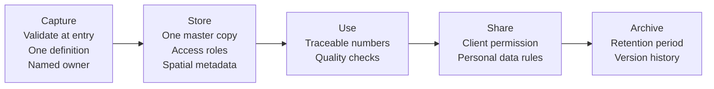

*Across every stage: owners, standards, and regular reviews.*

These steps work best in roughly this order:

1. Start with decisions, not data. List the decisions that matter most, then the data behind them. That's what you govern first.
2. Name owners from the business, not IT. The person who uses the data to make decisions should own its definition and quality, with IT supporting the systems.
3. Agree definitions. A short data dictionary of key terms and codes prevents most arguments before they start. One page is better than none.
4. Build rules into the tools. Required fields, drop-down lists instead of free text, validation, user roles, and audit logs enforce governance without anyone having to remember a policy.
5. Keep one master copy. Connect systems instead of copying data between them, because every copy is a future disagreement.
6. Record lineage and metadata. Note where data came from and what was done to it. For spatial data, always record the coordinate system, capture date, accuracy, and processing version.
7. Set sharing and retention rules. Decide in advance what goes to clients and partners, who approves it, and when data is archived or deleted.
8. Measure quality and review regularly. Track a few simple measures, such as completeness or timeliness, and review them with the owners on a fixed schedule.

[ADD: how you applied these on a multi-stakeholder engineering programme, and which step was hardest]

### Common mistakes

- Writing the policy first. A governance document nobody reads changes nothing, so start with rules built into tools and write down what already works.
- Making it IT's job. IT can run the systems, but the people who create and use the data have to own it.
- Governing everything at once. Covering every dataset on day one stalls the effort, so start with the data behind your most important decisions.
- Rules without enforcement. If the app lets people skip a required field, the rule doesn't exist.
- Forgetting the people. Governance changes habits, so it faces the same adoption problem as any new system. Explain why, make it easy, and show the benefit.

### A starter checklist

If you're starting from nothing, these ten steps cover most of the value:

- [ ] List the 5 to 10 datasets behind your most important decisions
- [ ] Name one owner for each
- [ ] Write one-line definitions for the key terms and codes they use
- [ ] Add validation to the apps where that data is entered
- [ ] Set access roles: who can view, edit, export, and delete
- [ ] Keep one master copy and retire the duplicates
- [ ] Record source, capture date, and for spatial data the coordinate system and accuracy
- [ ] Agree what may be shared with clients and partners, and who approves it
- [ ] Set retention periods, especially for personal data
- [ ] Track a few data quality measures and review them regularly

### To add before publishing

- [ ] One real moment where missing governance caused a problem, or good governance settled an argument
- [ ] How you set up governance on a multi-stakeholder engineering programme: owners, standards, and what was hardest
- [ ] How client data was handled in your geospatial projects (permissions, sharing, retention), without naming clients
- [ ] Whether the enterprise app had specific governance features (roles, validation, audit trail)
- [ ] Legal check: confirm the current state of the Personal Data Protection Law and Geospatial Information Law requirements before publishing
- [ ] Decide whether this becomes Part 3 of the construction series or stands alone

### Site metadata

```yaml
title: "Data Governance Without the Bureaucracy"
lang: en
translationKey: data-governance-practical-guide
categories: [digital-transformation, geospatial-ai]
tags: [data-governance, data-quality, compliance, geospatial-data]
summary: "A practical guide to data governance: what needs governing, why it matters, and how to build it into everyday tools."
published: null
updated: null
comments: true
map: false
draft: true
```

---

## A4. Spatial AI in Practice

*Lessons from applying AI to drone, satellite, and sensor data across infrastructure, agriculture, energy, and environmental projects in Indonesia.*

"Spatial AI" sounds like a product you can buy. In my projects it has been a way of working: machine learning on data where location matters, such as aerial imagery, satellite scenes, LiDAR point clouds, and sensor readings tied to a place.

It can count thousands of structures across a construction site, classify land cover across a region, or flag slopes likely to fail before anyone walks them. After many projects, though, the model has rarely been the hard part. Whether it works has depended on getting the right data, the right ground truth, and the right people around the model.

Below are the five kinds of task it handles well, what makes it hard in Indonesia, and the rules I follow on every project now.

### Five things spatial AI does well

Most spatial AI work falls into five kinds of task. Each has an example from my projects.

| Task | What it means | Example from my work |
| --- | --- | --- |
| Detect and count | Find specific objects in imagery and count them | Detecting every building on a new capital city site; counting pile caps, bored piles, and girders along a 142 km railway corridor |
| Classify | Label each area by what it is | Deep learning land cover classification feeding a landslide warning system; separating forest, farmland, and mining sites |
| Track change | Compare data over time to see what's new or gone | Building a dated history of what was built, when, and where on a construction site |
| Predict | Estimate something that can't be seen directly, or that hasn't happened yet | A Random Forest model forecasting landslide-prone areas daily; machine learning forecasting flood and erosion areas at hydropower sites; rice productivity estimated from drone and satellite data |
| Fuse | Combine many data sources into one picture | Drone, satellite, rain gauge, and SCADA data in one landslide early warning system |

"Predict" covers very different things. Some predictions are about the present (how productive is this field?), others about the future (will this slope fail?). The second kind is much harder to validate.

### The model is one step of five

On every project I've worked on, the model was one step of five, and rarely the one that decided how it turned out.

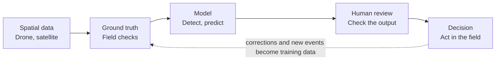

Spatial data has to be captured at the right time, resolution, and conditions. Ground truth, checked in the field, is what the model learns from and is tested against. The model does the detecting, classifying, or predicting. Human review catches what the model gets wrong, and the decision is what someone then does with the result.

The dashed line is the one to watch. Every correction a reviewer makes, and every new event observed in the field, is fresh ground truth. Projects that close this loop keep improving, and projects that don't slowly drift out of date.

### What makes it hard in Indonesia

Tropical cloud cover hides the ground in much optical satellite imagery. Dry-season composites, radar, and drones flown under the cloud are often the only way to get consistent data.

Global models don't know local objects. On one construction site, small temporary workers' sheds (*bedeng*) were not reliably recognised, so we added manual checks. Local training data has mattered more to us than model architecture.

Ground truth is scarce and expensive, because every model needs examples checked in the field. Reaching remote sites takes time, money, and permits, so ground truth is usually the most limited resource on the project.

A model calibrated in one place may not transfer. In a national rice assessment, ground truth came from Java, but rain-fed fields elsewhere behave differently, so estimates far from the calibration areas carry more uncertainty.

Landslides, floods, and similar hazards are infrequent at any single location, so there are few examples to train on. Balancing false alarms against missed warnings has to be tuned with the people who receive them.

Coastlines shift with the tide and crops change with the season. Unless imagery dates and conditions are controlled, the model learns noise instead of change.

### Seven rules I follow now

1. Start with the decision. Ask what someone will do differently because of the output. On a construction site, the decision was whether a structure stood in a permitted area, and everything else was built around that.
2. Budget for ground truth first. Field data, labelling, and validation are where accuracy comes from, so plan them before choosing a model.
3. Train on local examples. A model that has never seen a bedeng won't find one, so collect and label examples from the place you're working.
4. Keep a human in the loop. Send uncertain results to people for review, and feed their corrections back into training.
5. Choose models people can understand. A Random Forest can show which inputs drove a landslide forecast, which helped operators trust it. Sometimes a simpler, explainable model is the better choice.
6. Don't use AI where physics or statistics will do. Our coastline forecast for Belitung Island relied on regression across six shorelines and a physical sea-level rule, not deep learning.
7. Deliver in a form people use. Video walkthroughs, a daily risk report, and dashboards got our results acted on. A model output nobody opens has no value.

### To add before publishing

- [ ] One accuracy figure you can share, for example detection accuracy on structures or how often forecasts were right
- [ ] The models or libraries you used most (for example YOLO, U-Net, scikit-learn), if you're happy to name them
- [ ] A failure story beyond the bedeng example: a model that didn't work and what you changed
- [ ] Whether the Belitung example fits: confirm the forecast relied on regression and the Bruun Rule rather than AI
- [ ] Links to the related case studies once they're published

### Site metadata

```yaml
title: "Spatial AI in Practice"
lang: en
translationKey: spatial-ai-in-practice
categories: [geospatial-ai, digital-transformation]
tags: [spatial-ai, machine-learning, remote-sensing, ground-truth, lessons-learned]
summary: "What spatial AI does well, why it struggles in tropical and local conditions, and seven rules for making it work."
published: null
updated: null
comments: true
map: false
draft: true
```

---

## A5. Generative AI for a Small Geospatial Team

*How generative AI changed the way a small geospatial and digital transformation team works, and where it still can't be trusted on its own.*

In an earlier article I wrote about spatial AI: models that detect, classify, and predict from drone, satellite, and sensor data. Generative AI is different. It doesn't measure the world; it produces text, code, and images on request.

Spatial AI improves the analysis. Generative AI speeds up what surrounds it: writing software, drafting reports, translating, and turning technical work into something others can read.

It has made us faster, and it has produced some confident mistakes. Both are below.

### Where it helped

| Use | What we did | What changed |
| --- | --- | --- |
| Prototyping software | Built a prototype wildfire early-warning system for a district in West Java with an AI coding assistant (Claude Code) | A working prototype in [ADD: time taken] instead of [ADD: usual estimate] |
| Building a website | Built this bilingual site, a static site with maps, search, and two languages, with the same assistant | A small team could build and maintain it without a dedicated web developer |
| Translation | First-draft English to Bahasa Indonesia translation of every article, checked against a technical glossary | Publishing in two languages became realistic |
| Presentations | Turned a technical coastline analysis into a slide summary with an AI notebook tool (NotebookLM) | Hours of slide-making reduced, with problems described below |
| Writing | Drafted case studies and articles from project notes, then corrected and filled in the details | Writing time went to the parts only we could write: facts, lessons, and judgement |

Generative AI is fastest at producing a first version. What people do with that version decides its value.

### Where it went wrong

The AI-generated slides for our coastline study looked polished, but the coordinate labels on the maps were wrong, placing a near-equatorial island at latitudes around 40 to 55 degrees. Anyone with GIS training would spot it immediately, and it undermines everything else on the slide. We now export maps from QGIS and never publish AI-drawn maps.

Asked to write about a project with incomplete notes, generative AI fills the gaps with things that sound right. In our own case study drafts, the useful habit was the opposite: mark unknowns as [TO CONFIRM] and let the person who did the work fill them in.

When source documents disagree, for example two versions of a forecast year, AI tends to pick one quietly. Those conflicts need to be surfaced, not hidden.

Geospatial terms often have an established Indonesian usage, or none at all. Without a glossary, translations drift between versions.

Pasting client data, imagery, or internal figures into public AI tools can break contracts and trust. What goes into the tool matters as much as what comes out.

### Where to use it, and where not

Two questions decide whether generative AI fits a task: how easy is it to check the output, and how costly is an error if one slips through?

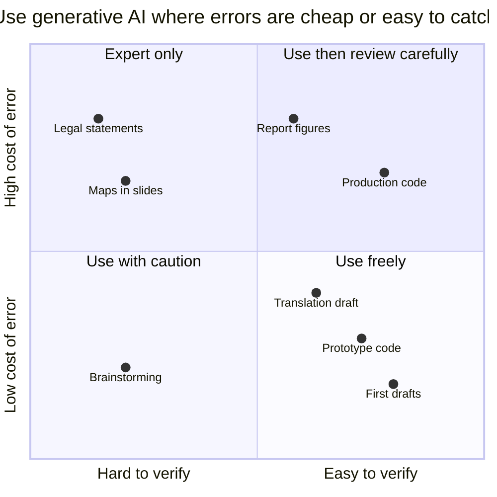

First drafts, prototype code, and translation drafts sit in the safe corner, where mistakes are cheap and easy to spot. Production code and report figures cost more when wrong, so they need careful review. The dangerous corner is where errors are both costly and hard to spot, and our AI-generated maps landed there. The wrong coordinates looked plausible at a glance.

### Six rules we follow

1. A person owns every fact. AI can draft, but the person who did the work confirms every number, place, and claim before it goes out.
2. Mark unknowns instead of filling them. Ask the tool to flag what it doesn't know, and fill the gaps from project records.
3. Never publish AI-drawn maps or figures. Maps and charts come from GIS and analysis tools, where every coordinate and value can be traced.
4. Keep client data out of public tools. Use approved tools for confidential work, or remove anything identifying before using AI.
5. Give it your standards. A glossary for translation, a style guide for writing, and project conventions for code make output consistent from the first draft.
6. Review AI-written code like a colleague's. It still needs testing and review, especially before it touches client data or production systems.

### To add before publishing

- [ ] Wildfire prototype: confirm the details (district, what the prototype did, time taken compared with a usual estimate). This came from your CV, so check it is described accurately
- [ ] Whether you're comfortable naming the tools (Claude Code, NotebookLM), or prefer generic terms
- [ ] One more failure or surprise from your own use of generative AI
- [ ] Your team's actual policy on client data and AI tools, if one exists
- [ ] Links to the Spatial AI article and related case studies once published

### Site metadata

```yaml
title: "Generative AI for a Small Geospatial Team"
lang: en
translationKey: generative-ai-small-team
categories: [digital-transformation]
tags: [generative-ai, ai-assisted-development, translation, lessons-learned, perspectives]
summary: "Where generative AI sped up a small geospatial team, where it produced confident mistakes, and the rules that keep it useful."
published: null
updated: null
comments: true
map: false
draft: true
```

---
## A6. When Clients Ask for Blockchain, Quantum or AI First

*Lessons from conversations with clients who asked for a technology before they knew their problem.*

In digital transformation work, one request keeps coming back. It is rarely "we have this problem." More often it is "we want blockchain," or "we should be ready for quantum," or "we need AI." The technology arrives first, and the problem is supposed to follow.

These words are in every conference keynote and annual report, and nobody wants to be left behind. But starting from the technology almost always leads to the wrong solution, or the right one at ten times the cost.

### Blockchain: usually a request for trust

Many organisations ask for blockchain without being able to say why. In my experience, when you dig into the request, a simple database would usually do the job better and cost less.

[ADD: one anonymised example of a client who asked for blockchain, and what they actually needed]

What people want when they say "blockchain" is usually trust: records nobody can quietly change, and a history everyone can check. Those are good goals, but a blockchain is only one way to reach them, and an expensive one. It earns its cost in a narrow situation: several parties who don't trust each other must write to the same record, and there's no single operator they would all accept to run it.

Researchers Karl Wüst and Arthur Gervais of ETH Zurich turned this into a decision flow in their 2018 paper *Do You Need a Blockchain?* A simplified version:

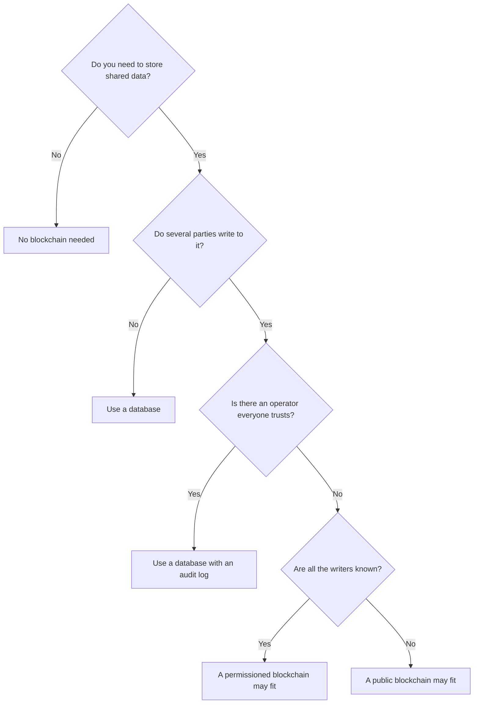

Most requests stop at the first or third question. If one organisation owns the data, or there's an operator everyone accepts, such as a ministry or an established agency, a well-governed database with access control and an audit log gives the same trust at a fraction of the cost. Some critics argue that even the permissioned outcome is rarely needed.

A blockchain also guarantees only that a record hasn't changed, not that it was right in the first place. If the data going in is wrong, the blockchain preserves the error permanently. The hard problems are usually data quality and governance, so I'd start there.

### Quantum computing: it works alongside classical computers

The most common misconception I hear is that quantum computers will replace today's computers, just faster. They won't. Quantum computers are not faster general-purpose machines. They are expected to excel at specific kinds of problems, mainly:

- Simulating molecules and materials, relevant to chemistry, drug discovery, and battery research.
- Certain mathematical problems, most famously factoring large numbers, which is why encryption is the main security concern.
- Possibly some optimisation problems, although how much quantum computers will help here is still debated.

For almost everything else, including databases, web applications, spreadsheets, and GIS processing, classical computers remain the right tool. Quantum computers also depend on classical computers to control them, prepare their inputs, and correct their errors. The likely future is hybrid: classical systems do most of the work and hand specific sub-problems to quantum hardware. IBM's quantum leadership has said publicly that classical and quantum computing will coexist for the long term rather than replace each other.

Timelines are also longer than headlines suggest. As of 2026, a Forrester report on the state of quantum computing estimated that, even under optimistic scenarios, fully fault-tolerant quantum computers able to deliver transformational value are at least five years away.

For most organisations, the practical quantum question is security. Data encrypted today could be stored and decrypted later once powerful quantum computers exist, a risk often called "harvest now, decrypt later." Organisations holding data that must stay confidential for many years, such as personal records, land data, or sensitive infrastructure maps, should start planning a move to post-quantum cryptography. [VERIFY: current status of NIST post-quantum cryptography standards before publishing]

### AI: the model is the smallest part

With AI, the misconception is different. People believe in it, often rightly, but picture it as something you buy and switch on. In my experience, the model is the smallest part of an AI project. Ground truth from the field, local training data, human review, and a clear decision to support count for more.

I've written about this in detail in *Spatial AI in Practice*. The short version: ask what decision the AI will improve, check that the data to support it exists, and plan for people to review its output. If those three aren't in place, no model will help.

### Start from the problem

Blockchain, quantum computing, and AI are very different technologies, but each request makes the same mistake: choosing the tool before understanding the job. Good digital transformation starts from the job.

Before naming a technology, answer five questions:

- [ ] What problem are we solving, and for whom? One sentence, without naming a technology.
- [ ] What's the simplest thing that would work? Often a database, a form, or a better process.
- [ ] What has to be true for it to work? Clean data, trusted owners, people willing to change habits.
- [ ] What would this technology add that the simple option can't? If there's no clear answer, the simple option wins.
- [ ] How will we know it worked? A measure agreed before starting.

The right technology solves the problem, gets used, and is something the organisation can afford to run.

### To add before publishing

- [ ] A blockchain request, anonymised: who asked, what they wanted it for, and what they actually needed
- [ ] A quantum conversation, if you have one: who believed it would replace their computers, and how you explained it
- [ ] Verify the post-quantum cryptography status (NIST standards and any Indonesian guidance) as of the publishing date
- [ ] Re-check the quantum timeline before publishing; the field moves quickly, and the Forrester and IBM figures are as of 2026
- [ ] Sources to link: Wüst and Gervais, "Do You Need a Blockchain?" (2018); Forrester, *The State of Quantum Computing, 2026*; IBM's public quantum roadmap
- [ ] Link to the Spatial AI and data governance articles once published

### Site metadata

```yaml
title: "When Clients Ask for Blockchain, Quantum or AI First"
lang: en
translationKey: blockchain-quantum-ai-needs
categories: [digital-transformation]
tags: [perspectives, blockchain, quantum-computing, ai, emerging-technology]
summary: "Why 'we want blockchain' usually means 'we want trust', why quantum computers will complement rather than replace classical ones, and how to start from the problem instead of the technology."
published: null
updated: null
comments: true
map: false
draft: true
```

---

## A7. Geospatial AI in Indonesia Starts With One Map

*An opinion piece on geospatial AI in Indonesia and the One Map Policy.*

Talk about the future of geospatial AI usually turns to models: better object detection, sharper satellites, faster processing. In Indonesia, I think the most important development is a map.

The One Map Policy (*Kebijakan Satu Peta*) aims to give the country one geospatial reference, one standard, one database, and one geoportal. That sounds like bureaucracy, but it changes what geospatial AI can do. A model can find a building, a mine, or a cleared forest. On its own it can't say whether that thing *should* be there. For that it needs an agreed map of boundaries, permits, and plans to compare against.

Across my projects, the most useful AI work has been exactly that comparison: structures checked against permitted areas, mining sites against licences, coastlines against their past. One Map would let the whole country do that, instead of one project at a time.

### Where One Map stands today

A few facts as of October 2026, from public sources:

| Milestone | Detail | Source |
| --- | --- | --- |
| Legal basis | Presidential Regulation No. 9 of 2016 accelerated the policy at a map accuracy of 1:50,000 | Perpres 9/2016 |
| Scope (2024) | Reported to involve 24 ministries and agencies, 34 provinces, and 158 thematic maps, with work underway on more detailed 1:5,000 base maps | Bisnis Indonesia, April 2024 |
| Early use | Thematic maps already used for agrarian reform, oil palm cover mapping, and the national anti-corruption strategy | Bisnis Indonesia, April 2024 |
| Single land map | Single map completed for Sulawesi; 2026 focused on the rest of Sumatra and Kalimantan | Minister of ATR/BPN, January 2026 |
| Target | Completion targeted before 2028, to help resolve agrarian conflicts | Minister of ATR/BPN, January 2026 |

Progress has been slower than first hoped, which is common when many institutions have to agree on one version of the truth. The target is before 2028, close enough that practitioners can start preparing for what comes after.

### Five predictions

I expect the pieces to fit together like this: One Map as the agreed reference, observation data on top, and AI comparing the two. The five predictions below are my own reading, and I'm not certain of them.

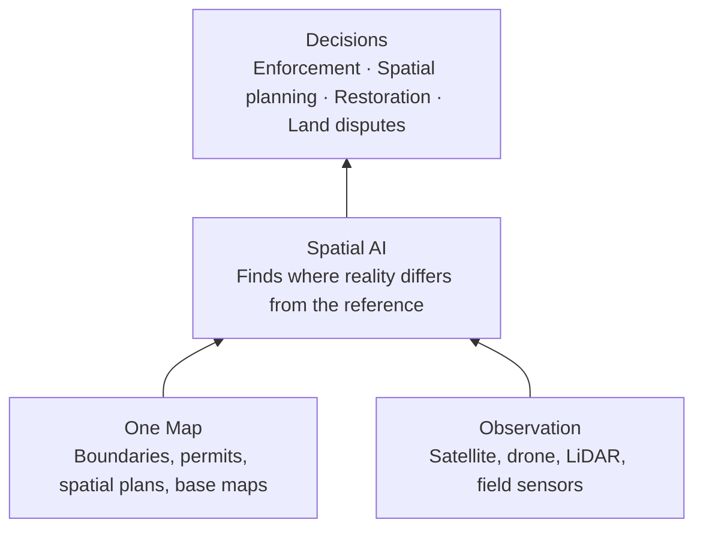

#### 1. AI will shift from making maps to checking them

For years, much geospatial AI work in Indonesia has been about producing maps: land cover, building footprints, crop areas. Once an agreed reference exists, the higher-value task becomes comparison. Is this structure inside a permitted area? Is this mine inside a licence? Is this clearing inside a designated forest? On a new capital city site, our core deliverable was exactly that: every detected structure checked against where building was allowed. One Map would make that check possible everywhere, instead of only where a client supplies the reference.

#### 2. Monitoring will replace one-off mapping

A map is a snapshot; most decisions need to know what changed and when. I expect more work to move towards continuous monitoring: detailed drone baselines a few times a year, with satellite and radar data in between. We used this pattern for a landslide early warning system, and it fits enforcement, agriculture, and coastal management equally well. For providers, that means services rather than projects.

#### 3. Detail will move from policy scale to parcel scale

The original One Map target was 1:50,000, good enough for national planning but not for deciding whether one building or one field is in the right place. The push toward 1:5,000 base maps raises the bar. Drones and LiDAR will fill in the detail, and AI will be needed simply to process the volume.

#### 4. Local data will be the competitive advantage

Global AI models are trained mostly on other countries' landscapes. They struggle with Indonesian specifics: small temporary sheds on construction sites, smallholder plots, mixed agroforestry, persistent cloud. Whoever builds good Indonesian training data and ground truth will build better models than anyone importing a generic one. I'd like to see more of that data shared openly.

#### 5. Trust will decide adoption

When AI results feed into agrarian conflicts, enforcement, or permits, they must stand up to scrutiny. That means traceable data, explainable methods, dated evidence, and human review. A detection from a model should be treated as a lead for investigation, not a verdict. Data governance will count for as much as model accuracy.

### What could slow it down

- One map means many institutions agreeing on one version of boundaries and permits. That's a governance challenge before it's a technical one.
- A single map is only valuable if it's kept updated. A reference that falls years behind reality will produce false alarms.
- If the reference layers are hard to access for the companies and researchers building AI on top of them, adoption will stay inside government.
- Indonesia needs more people who combine GIS, AI, and domain knowledge in agriculture, mining, forestry, and infrastructure. Tools are easier to buy than this combination.
- Tropical cloud cover and remote terrain don't go away. Radar, drones, and patient fieldwork stay essential.

### What practitioners can do now

1. Align with the national standards. Use the national reference system (SRGI2013) and record full metadata, so your data can be compared with One Map layers without rework.
2. Learn change detection as well as classification. Finding where reality differs from the reference, and when it changed, will be worth the most.
3. Build local training data. Label Indonesian examples, from small sheds to smallholder plots, and consider sharing what you can openly.
4. Design for evidence. Keep dates, sources, and processing steps for every output, so results can stand up in planning decisions and disputes.
5. Think in services rather than projects. Clients will increasingly need ongoing monitoring rather than one-off maps, so plan your tools, pricing, and teams for that.

One Map won't do anything on its own. Its value depends on being kept current and on people building on it.

### To add before publishing

- [ ] Re-check One Map status on the publishing date; the facts table is as of October 2026, and the 2028 target may move
- [ ] Link sources: Perpres 9/2016; Bisnis Indonesia (April 2024) on scope and use; ATR/BPN statements (January 2026) on progress and the 2028 target
- [ ] Verify the geoportal name and access (for example Ina-Geoportal) before mentioning it
- [ ] Your own view on the boldest prediction: which one you'd stake your reputation on
- [ ] An example of One Map data you've used, or wished you could use, in a project
- [ ] Links to the IKN, illegal mining, and Belitung case studies once published

### Site metadata

```yaml
title: "Geospatial AI in Indonesia Starts With One Map"
lang: en
translationKey: one-map-geospatial-ai-indonesia
categories: [geospatial-ai]
tags: [perspectives, indonesia, one-map-policy, spatial-ai, change-detection, governance]
summary: "Why the One Map Policy matters more than any algorithm, and five predictions for geospatial AI in Indonesia."
published: null
updated: null
comments: true
map: false
draft: true
```

---

## A8. GeoScholar: Cited Answers from Remote Sensing Papers

*An internal question-answering tool I built at work, and how I measured whether its answers can be trusted.*

GeoScholar is an internal tool I built for work. Colleagues ask a question in plain English and get an answer drawn from 399 recent remote sensing papers. Each claim names the paper section behind it, and when the papers don't contain the answer, the tool says so. It runs on one desktop with free, open language models, and the code is on [GitHub](https://github.com/justinthe/geoscholar). I built it over 6 weeks, at about 10 hours a week. The technique is called retrieval-augmented generation (RAG): the system first searches a document collection, then has a language model write an answer from what it found. I measured every design choice on a 99-question test set instead of assuming it. The best setup combines two kinds of search and then re-sorts the results. It puts the right paper in the top 5 search results for 97.2% of questions (R@5 0.972).

<figure><video src="/geo-dt-site/geoscholar/demo.mp4" poster="/geo-dt-site/geoscholar/cover.png" autoplay muted loop playsinline aria-label="GeoScholar answering a question with cited sources"></video><figcaption>Asking GeoScholar a question. The answer cites its sources as [S1], [S2] and so on, and the app shows each one as a paper ID and section. A question the papers can't answer gets a fixed refusal.</figcaption></figure>

### At a glance

| | |
| --- | --- |
| **Papers** | 399 papers from arXiv (a free public archive where researchers post papers), in the computer vision and image-processing categories, cut into 19,650 text pieces |
| **Tools** | Qdrant (a search database), GROBID (a program that reads PDFs and finds their sections), bge-small-en-v1.5 (a model that turns text into numbers that capture its meaning), bge-reranker-base (a model that re-sorts search results), Llama 3.1 8B (the open language model that writes the answers), Ollama (a free program that runs language models on your own computer), FastAPI and Streamlit (the web service and the app screen), Docker Compose (starts everything with one command) |
| **Hardware** | One desktop graphics card (RTX 3060, 12 GB of memory) |
| **Test set** | 99 questions: 91 the papers can answer and 8 they can't |
| **Code** | [github.com/justinthe/geoscholar](https://github.com/justinthe/geoscholar) |

### Results in brief

- **Finding the right paper:** the right paper was in the top 5 results 97.2% of the time (R@5 0.972). On average it landed very near the top (MRR 0.954, where 1.0 means always first).
- **Knowing when not to answer:** it refused all 8 questions the papers can't answer, and wrongly refused 1 of the 91 it could.
- **Staying faithful to the sources:** 88.5% of the claims in its answers were judged supported by the cited text (faithfulness 0.885) when one AI judge scored them, and 85.5% with a second judge. 80.2% of claims carry a citation.
- **Speed:** a typical answer takes 4.5 seconds. About 0.4 seconds is search and re-sorting, and the rest is the model writing.

### Terms used on this page

- **Recall@5 (R@5):** how often the right paper shows up in the top 5 search results. R@1 and R@10 are the same for the top 1 and top 10.
- **MRR (mean reciprocal rank):** how near the top the right result lands. 1.0 means it is always first.
- **Keyword search (BM25):** finds text that shares exact words with the question.
- **Meaning-based search (dense embeddings):** each piece of text is turned into a list of numbers (a vector) so that pieces with similar meaning get similar numbers. The question gets the same treatment, and the closest pieces win, even when the words differ.
- **Hybrid search:** runs both and merges the two result lists with a standard formula called reciprocal rank fusion.
- **Re-sorting the top results (reranker):** a second model reads each question and candidate together and puts the best first.
- **Text pieces (chunks):** the slices each paper is cut into for search. Sizes are counted in tokens, roughly word fragments. A piece can repeat the end of the one before it (overlap), so a sentence on the boundary isn't lost.
- **Faithfulness:** the share of an answer's claims that the source text actually supports.
- **Citation coverage:** the share of claims that carry a source tag such as [S2].
- **Kappa:** agreement between two judges beyond chance. 0.7 is substantial, 1.0 is perfect.
- **p50 latency:** the typical wait. Half of requests are faster than this.
- **Judge:** a language model asked to grade answers.
- **Noise:** a difference too small to tell apart from chance.

### How it works

```mermaid
flowchart LR
  title GeoScholar: from papers to a cited answer
  subgraph IN["Preparing the papers (once)"]
    A["arXiv<br/>6 topics, computer vision and image processing"] --> B["PDF download"]
    B --> C["GROBID<br/>Reads sections and text"]
    C --> D["Text pieces (chunks)<br/>300 tokens, 50 overlap"]
    D --> E["bge-small<br/>Turns text into numbers that capture meaning"]
    E --> F[("Qdrant<br/>Search database")]
  end
  subgraph Q["Each question"]
    Q1["Question"] --> R1["Meaning-based search (dense)<br/>30 candidates"]
    Q1 --> R2["Keyword search (BM25)<br/>30 candidates"]
    R1 --> RRF["Merge the two lists<br/>(reciprocal rank fusion)"]
    R2 --> RRF
    RRF --> RR["Re-sort (bge-reranker)<br/>Keep top 5 pieces"]
    RR --> L["Llama 3.1 8B<br/>Strict prompt, fixed refusal line"]
    L --> ANS["Answer with [S#] citations"]
  end
  F --> R1
  F --> R2
  ANS -.-> EV["Evaluation<br/>Recall@k, MRR, AI judge"]
```

- **Fetch and parse:** the arXiv programming interface supplies papers on six topics. GROBID turns each PDF into sections, so no text piece crosses a section boundary.
- **Index:** each text piece is converted to numbers that capture its meaning and stored in Qdrant. A keyword index sits beside it.
- **Retrieve:** meaning-based search and keyword search each return 30 candidates. Reciprocal rank fusion merges them, and a reranker keeps the best 5.
- **Generate:** the model must cite every factual sentence as [S#] and reply with one fixed refusal line when the sources don't answer the question.
- **Evaluate:** recall and MRR measure the search. Citation checks and an AI judge measure the answers.

### Ingestion

The run fetched 400 papers and indexed 399, because one PDF download returned a 404. GROBID parsed all 399 papers with no fallback, giving 19,650 text pieces (49 per paper on average). The index stage took about 14 minutes.

I compared GROBID with PyMuPDF, a simpler PDF-reading library, on 5 sampled papers. PyMuPDF keeps all the text but returns one flat block with no headings. GROBID gives usable sections, but in 2 of the 5 papers the abstract came out as figure-caption text. I chose GROBID so I could cut text pieces by section, and noted the abstract problem as a fix to make.

### Retrieval evaluation

The test uses 91 answerable questions: 73 generated from the indexed text and 18 I wrote by hand. A hit means the right paper appears in the top results. R@1, R@5 and R@10 are the hit rates for the top 1, 5 and 10 results.

| Search setup | R@1 | R@5 | R@10 | MRR | p50 latency |
| --- | --- | --- | --- | --- | --- |
| Meaning-based (dense) | 0.772 | 0.878 | 0.908 | 0.844 | 6 ms |
| Keyword (BM25) | 0.879 | 0.945 | 0.966 | 0.929 | 26 ms |
| Both merged (hybrid) | 0.818 | 0.952 | 0.993 | 0.901 | 37 ms |
| Meaning-based + re-sort | 0.888 | 0.936 | 0.949 | 0.931 | 374 ms |
| Hybrid + re-sort | 0.912 | 0.972 | 0.984 | 0.954 | 413 ms |

Key: R@k is the share of questions with the right paper in the top k. MRR is closeness to the top, 1.0 being always first. p50 latency is the typical search time, in milliseconds (ms).

Hybrid plus re-sorting is best on R@1, R@5 and MRR. Its R@5 gain over plain hybrid (+0.020) is within noise, but the R@1 gain is real: +0.094, with an uncertainty range of +0.037 to +0.162. I got that range by resampling the questions many times and checking how much the gain moved each time (a paired bootstrap). The price is about 10 times the wait, 37 ms to 413 ms. That is still well under half a second.

The two search types fail in opposite places. On questions that use exact terms, keyword search scores 0.952 and meaning-based search 0.690. On rephrased questions it flips: meaning-based 1.000, keyword 0.571. Hybrid scores 0.881 and 1.000 on the two groups. Each group has only 7 questions, so this shows a pattern and doesn't prove it.

### Text piece size: 150 vs 300 vs 450 tokens

Text pieces never cross a section boundary, so actual sizes sit below the cap: 117, 208 and 278 tokens on average. With hybrid plus re-sorting, R@5 was 0.952, 0.972 and 0.952, and the differences are within noise. The typical wait grew with piece size: 277 ms, 401 ms and 498 ms. I kept 300. Once re-sorting is on, piece size mostly changes speed, not quality.

### Answer quality

For each answer I checked four things: the right paper was among the sources, the model refused when it should, claims carry citations, and an AI judge found them supported. I tested three variants against a baseline of 5 sources in relevance order.

| Variant | Right paper in sources (hit rate) | Claims supported (faithfulness) | Claims with a citation (citation coverage) | Typical wait (p50 latency) | Refusals (of 99) |
| --- | --- | --- | --- | --- | --- |
| Baseline (5 sources) | 1.000 | 0.885 | 0.802 | 4.45 s | 9 |
| Sandwich order, 5 sources | 1.000 | 0.895 | 0.818 | 4.77 s | 10 |
| 3 sources | 0.956 | 0.888 | 0.789 | 4.49 s | 12 |
| 8 sources | 1.000 | 0.906 | 0.800 | 5.21 s | 10 |

Key: faithfulness is the share of an answer's claims the source text supports. Citation coverage is the share of claims that carry a source tag.

- **Sandwich ordering** puts the best text piece first and the second best last, because models tend to pay less attention to the middle of a long prompt. It made no measurable difference: the change in supported-claim share was +0.002 (range -0.016 to +0.021).
- **3 sources** lost the right paper on 4 questions (hit rate 0.956), and refusals rose from 9 to 12.
- **8 sources** was 17% slower with no gain outside noise.

I kept 5 sources in relevance order. Each variant was run once, with the model's randomness turned down so repeat runs give similar answers, and the model judged its own answers, so small differences are not reliable.

### Can the judge be trusted?

Two AI judges scored the baseline answers: the same model that wrote them (Llama 3.1 8B) and a second open model from a different developer, Qwen2.5 7B. They agreed on 89.7% of 262 claims (kappa 0.70, substantial agreement). They differ more on relevance: Llama rated 0.778 of answers as fully relevant and Qwen 0.600. So I treat the relevance score as relative only, and lead with the measures that need no judge.

I also compared both judges with a second opinion on 30 claims. Those labels came from Claude, not from a human. Against them, Llama had kappa 0.80 and Qwen 0.93. Claude and the two judges may share blind spots that a human would not, and a human check is still to do.

### Lessons learned

1. **Keyword and meaning-based search fail in opposite places.** Meaning-based search missed questions heavy on acronyms and product names, and keyword search missed rephrased questions. Hybrid search covers both.
2. **Re-sorting can only reorder what it is given.** Meaning-based search left the right paper out of the top 10 for 6 questions, hybrid for none. Re-sorting also hurts sometimes: on one question it moved the right paper from rank 1 down to rank 6.
3. **Generated questions favour keyword search.** Keyword search scored 1.000 on the 73 generated questions. On the 18 I wrote by hand it scored 0.720 against 0.870 for hybrid. The hand-written set is the better guide to real queries, though 18 questions is small.
4. **Report the measures that need no judge first.** The 8B judge made arithmetic mistakes: it marked "requires 4 more rounds" as unsupported when the source says 11 rounds against 7.
5. **With re-sorting on, text piece size is mostly a speed setting.**
6. **Questions that span several papers fail in every setup.** Four of them did. Pieces from one paper crowd out the others. Next step: keep one piece per paper before ranking.

### Site metadata

```yaml
title: "GeoScholar: Cited Answers from Remote Sensing Papers"
lang: en
translationKey: geoscholar-rag
categories: [geospatial-ai]
tags: [rag, remote-sensing, evaluation, internal-tools]
summary: "An internal tool that answers questions from 399 remote sensing papers with cited sources, and how I measured whether its answers can be trusted."
published: 2026-10-26
updated: null
comments: true
map: false
cover: cover.png
```
